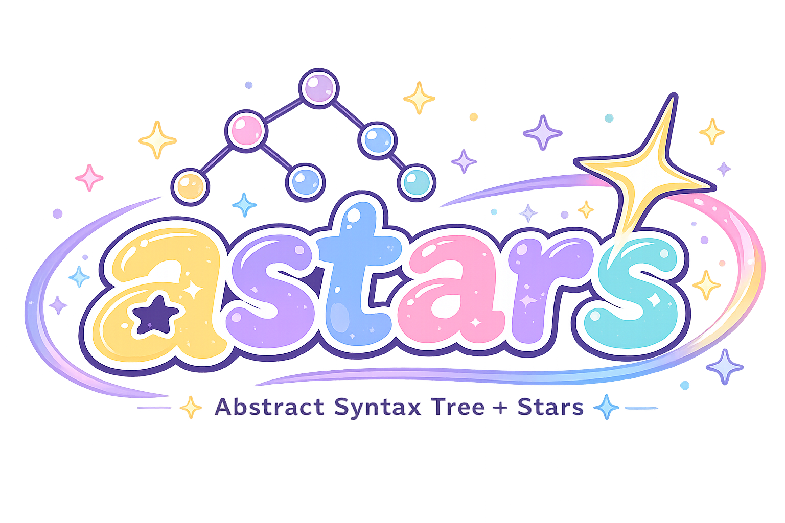

<p align="center">
  
</p>

<h1 align="center">Astars</h1>

<p align="center">
  <strong>A lightweight program-structure engine.</strong><br>
  <strong>軽量なプログラム構造エンジン。</strong>
</p>

Astars parses source code into an AST-like structure, lets users inspect and query
that structure, map nodes back to their original source spans and source text, and
apply a minimal source-aware edit primitive. Astars is intended to be a small
engine that downstream packages can build on, rather than a full analysis product
by itself.

Astars はソースコードを AST-like な構造に parse し、その構造を inspect・query
できるようにし、node を元の source span / source text に戻し、最小限の
source-aware な edit primitive を提供する。Astars は、それ単体で完結した分析
製品ではなく、downstream package が土台にできる小さな engine であることを
狙っている。

## Why Astars / Astars を選ぶ理由

- **Source-faithful, editable program structure.** Every node maps back to its
  exact source span, and the same engine that queries the tree can edit it -
  replace a node's span and immediately ask which original node spans do not
  overlap the reported changed range, so editing and re-analysis are one loop
  instead of two disconnected tools.<br>
  **Source-faithful で編集可能なプログラム構造。** すべての node が元の
  source span に正確に対応づいており、木を query するのと同じ engine でその
  まま編集もできる — node の source span を replace して、元のどの node span
  が報告された変更範囲と重ならないかをすぐ確認できるので、編集と再解析が
  別々のツールではなく同じ loop になる。

- **One Rust core, no per-language reimplementation.** Python and Node.js
  bindings share a single `astars-core` implementation with semantic parity for
  the shared capabilities, verified end-to-end in both runtimes - the same engine serves ML/research
  workflows (Python) and coding-agent tooling (Node) without duplicating
  logic.<br>
  **単一の Rust core、言語ごとの再実装なし。** Python/Node binding は単一の
  `astars-core` 実装を共有し、共通 capability の意味論が揃っている(両ランタイム
  で実機確認済み) — runtime ごとのAPI形状は異なるが、ML/研究向け(Python)と
  coding agent ツール向け(Node)を、ロジックを重複させずに同じ engine で支える。

- **Built for structured, LLM-friendly edits - not diffs.** Diff- and
  line-number-based edit formats break down on large files when a model
  mistranscribes a line; Astars lets a node be addressed and replaced
  directly, with the result immediately re-checkable, instead of requiring
  the model to retype surrounding context.<br>
  **diff ではなく、構造化された LLM フレンドリーな編集のために作られてい
  る。** diff/行番号ベースの編集形式は、モデルが行を書き写し損ねると大きな
  ファイルで崩れやすい。Astars は node を直接指定して replace でき、その
  結果をすぐ再検証できる — モデルに周辺コードを書き写させる必要がない。

- **A lightweight substrate for analysis tools, not a product.** Astars
  doesn't decide what a metric means or which refactor to apply; it provides
  the parse/query/edit/diagnose primitives that downstream packages
  (metrics, code review, pruning, LLM evaluation) can build on.<br>
  **分析ツールのための軽量な土台であり、プロダクトではない。** Astars は
  metric の意味やどの refactor を適用すべきかを判断しない。metrics・code
  review・pruning・LLM 評価のような downstream package が土台にできる、
  parse/query/edit/diagnose の primitive を提供する。

These are the engine's design goals, not all fully proven yet. Field-based
navigation is available in the current repository, while composite structural
selectors, stable cross-state node identity, and real downstream packages are
still open. See
[`docs/ACTION_ITEMS.ja.md`](docs/ACTION_ITEMS.ja.md)'s "Capability Status"
section for the exact, current status of each.<br>
これらは engine の設計目標であり、すべてが証明済みというわけではない。
field-based navigation は現在のrepositoryにある一方、複合structural selector、
stateを跨ぐ安定node identity、実際のdownstream packageはまだ無い。各項目の正確な現状は
[`docs/ACTION_ITEMS.ja.md`](docs/ACTION_ITEMS.ja.md) の「Capability Status」
節を参照。

## Project Status / プロジェクトの状態

**Astars's core engine was rewritten in Rust** (`crates/astars-core`), with
Python and Node.js as binding-based consumers (`bindings/python`, `bindings/node`
in this repository). See [`docs/strategy/STRATEGY.ja.md`](docs/strategy/STRATEGY.ja.md) for the
rationale and [`docs/ACTION_ITEMS.ja.md`](docs/ACTION_ITEMS.ja.md) for current
status.

**Astars の core engine は Rust で書き直した**(`crates/astars-core`)。
Python と Node.js はその binding 経由の consumer という位置づけになる(この
リポジトリの `bindings/python` / `bindings/node`)。方針の経緯は
[`docs/strategy/STRATEGY.ja.md`](docs/strategy/STRATEGY.ja.md)、現在の状況は
[`docs/ACTION_ITEMS.ja.md`](docs/ACTION_ITEMS.ja.md) を参照。

The Rust core has reached its v0 scope end-to-end through both bindings, and
`v0.2.0` is published:

```bash
pip install astars-py       # module name: _astars
npm install @astars/native
```

The previously published pure-Python implementation (`astars` 0.1.0 on PyPI)
is kept as a frozen reference under [`prototype-python/`](prototype-python/)
and is no longer under active development; see
[Installing the Previous Release](#installing-the-previous-release--以前のリリースをインストールする)
if you want that version instead. To build from source instead of installing
the published packages, see [Build From Source](#build-from-source--ソースからビルドする)
below.

Rust core は Python/Node 両 binding を通して v0 scope を一通り実装済みで、
`v0.2.0` を公開済みである:

```bash
pip install astars-py       # module 名: _astars
npm install @astars/native
```

以前公開していた純粋な Python 実装(PyPI 上の `astars` 0.1.0)は
[`prototype-python/`](prototype-python/) に frozen reference として残しており、
active development の対象ではない。そちらを使いたい場合は
[Installing the Previous Release](#installing-the-previous-release--以前のリリースをインストールする)
を参照。公開済みパッケージではなくソースからビルドしたい場合は、下の
[Build From Source](#build-from-source--ソースからビルドする) を参照。

The published v0.2.0 scope (Rust core):
公開済み v0.2.0 の scope(Rust core):

- parse Python source from a string, raw bytes, or a file (with encoding support)<br>
  Python source を文字列・raw bytes・ファイル(encoding 指定込み)から parse する
- inspect AST-like nodes - tree-sitter's raw CST, 1:1 - without touching
  parser-specific objects directly<br>
  AST-like な node を inspect する — tree-sitter の生 CST を 1:1 で使い、parser
  固有のオブジェクトには一切触れない
- walk the tree, find nodes by kind, and locate the most specific node at a byte
  offset<br>
  木を walk し、kind で node を find し、byte offset に対応する最も具体的な
  node を特定する
- map nodes to byte spans, source text, and 0-based line/column positions<br>
  node を byte span・source text・0-based の line/column 位置に対応づける
- a minimal edit primitive: replace a node's source span, and ask whether another
  original node span overlaps the reported changed range<br>
  最小限の edit primitive: node の source span を replace し、別の元node spanが
  報告された変更範囲と重なるかを問い合わせる
- parser-recovery diagnostics (syntax errors)<br>
  parser recovery による diagnostics(構文エラー)

The following are outside the v0 scope:
以下は v0 scope の対象外:

- insert/delete-specific edit methods, a Piece Table, edit lineage tracking, and
  composite structural selectors<br>
  insert/delete 専用の編集メソッド、Piece Table、編集の系譜追跡、複合的な
  structural selector
- a selector DSL<br>
  selector DSL
- a stable CST / raw-node public API<br>
  安定版の CST / raw node 公開 API
- semantic analysis<br>
  semantic analysis
- languages other than Python<br>
  Python 以外の対象言語
- downstream packages themselves (`astars-metrics`, `astars-code-review`, etc.)<br>
  downstream package 自体(`astars-metrics`、`astars-code-review` など)

The repository's unreleased HEAD additionally contains field navigation via
`child_by_field_name` and an independent-source changed-range approximation via
`diff_with`. These are candidates for the next release; they do not provide
cross-state node identity or structural matching.

repositoryの未release HEADには、`child_by_field_name`によるfield navigationと、
`diff_with`による独立source間のchanged-range近似も含まれる。これらは次回release
候補であり、stateを跨ぐnode identityやstructural matchingは提供しない。

## Build From Source / ソースからビルドする

Requires a recent Rust toolchain. Verify the core engine builds and tests on its
own first:

最近の Rust toolchain が必要。まず core engine 単体が build・test できることを
確認する:

```bash
git clone https://github.com/xwasoux/astars.git
cd astars
cargo test --workspace
```

### Python binding

```bash
cd bindings/python
python3 -m venv .venv && source .venv/bin/activate
pip install maturin
maturin develop
python3 ../../examples/python/basic_parse.py
```

### Node binding

```bash
cd bindings/node
npm install
npm run build:debug
node ../../examples/node/basic-parse.js
```

Both example scripts walk through the full v0 surface (query API, the edit
primitive, `parse_bytes`/`parse_file`, diagnostics, and `point_at`) against the
same sample source, so their output lines up one-to-one.

どちらの example script も、同じ sample source に対して v0 の全機能(query
API、edit primitive、`parse_bytes`/`parse_file`、diagnostics、`point_at`)を
一通りデモしており、出力は1対1で対応している。

## Quick Start

Python, via `import _astars` (the eventual `import astars` will be a thin wrapper
around this native module):

Python、`import _astars` 経由(将来の `import astars` は、この native module を
薄くラップする別パッケージになる予定):

```python
import _astars

tree = _astars.parse_str("def hello(name):\n    return name\n", _astars.PyLang.Python).tree

function = tree.find("function_definition")[0]
print(tree.span_of(function))      # (0, 32)
print(tree.source_of(function))    # 'def hello(name):\n    return name'
print(tree.point_at(0))            # (0, 0)
```

Node.js, via `@astars/native`:

Node.js、`@astars/native` 経由:

```js
const { parseStr, JsLang } = require('@astars/native');

const tree = parseStr('def hello(name):\n    return name\n', JsLang.Python);

const [fn] = tree.find('function_definition');
console.log(tree.spanOf(fn));   // [0, 32]
console.log(tree.sourceOf(fn)); // 'def hello(name):\n    return name'
console.log(tree.pointAt(0));   // [0, 0]
```

## Public API

The core engine (`astars-core`) exposes `Lang`, `ParseResult`, `SyntaxTree` (+
`NodeId`, `ByteSpan`, `Point`, `EditResult`, `Diagnostic`, `Severity`,
`AstarsError`), and
`parse_str` / `parse_bytes` / `parse_file`. Each binding mirrors this surface in
its own idiom:

core engine(`astars-core`)は `Lang`、`ParseResult`、`SyntaxTree`(+ `NodeId`、
`ByteSpan`、`Point`、`EditResult`、`Diagnostic`、`Severity`、`AstarsError`)、
`parse_str` /
`parse_bytes` / `parse_file` を公開している。各 binding はこの surface を
それぞれの言語の流儀でミラーする:

- Python (`_astars`): `PyLang`, `PyParseResult`, `PySyntaxTree`, `PyNodeInfo`,
  `PyEditResult`, `PyDiagnostic`, `parse_str` / `parse_bytes` / `parse_file`
- Node (`@astars/native`): `JsLang`, `JsSyntaxTree`, `JsNodeInfo`, `JsEditResult`,
  `JsDiagnostic`, `parseStr` / `parseBytes` / `parseFile`

For the architectural boundary and a compact view of the current types, see
[`docs/design/ARCHITECTURE.ja.md`](docs/design/ARCHITECTURE.ja.md). The binding
source and generated package documentation remain authoritative for the exact
method-level API.

architecture上の境界と現行型の要約は
[`docs/design/ARCHITECTURE.ja.md`](docs/design/ARCHITECTURE.ja.md)を参照する。
正確なメソッド単位のAPIはbinding sourceと生成されたpackage documentationを正とする。

## Design Boundary

Astars is an engine layer. It should answer questions such as:

Astars は engine layer である。次のような問いに答えるべきものである:

- What is the program structure of this source file?<br>
  この source file のプログラム構造は何か?
- Which nodes match this structural query?<br>
  この構造的な query にどの node がマッチするか?
- Where did this node come from in the original source?<br>
  この node は元の source のどこから来たのか?
- What source text corresponds to this node?<br>
  この node に対応する source text は何か?
- What changes if I edit this node, and what else is left untouched?<br>
  この node を編集したら何が変わり、他の何が影響を受けずに残るか?

Astars should not decide what a metric means, whether a code review finding is
important, or which LLM evaluation policy should be applied. Those decisions
belong in downstream packages such as `astars-metrics`, `astars-code-review`, or
`astars-llm-eval`.

Astars は、metric が何を意味するか、code review の指摘が重要かどうか、どの
LLM evaluation policy を適用すべきかを決めるべきではない。それらの判断は
`astars-metrics`、`astars-code-review`、`astars-llm-eval` のような downstream
package の責務である。

## Development

Rust workspace (`crates/astars-core`, `bindings/python`, `bindings/node`):

Rust workspace(`crates/astars-core`、`bindings/python`、`bindings/node`):

```bash
cargo test --workspace
cargo clippy --workspace -- -D warnings
```

Rebuilding a binding after a core change:

core を変更した後に binding を再ビルドする:

```bash
# Python
cd bindings/python && source .venv/bin/activate && maturin develop

# Node
cd bindings/node && npm run build:debug
```

Python prototype (frozen reference, in `prototype-python/`):

Python prototype(frozen reference、`prototype-python/` 配下):

```bash
cd prototype-python
python -m pytest
```

The previous release's public API is covered by
`prototype-python/tests/test_public_api.py`.

以前のリリースの public API は `prototype-python/tests/test_public_api.py` で
カバーされている。

## Installing the Previous Release / 以前のリリースをインストールする

The last Python-only release (`astars` 0.1.0, pre-Rust-migration) is still
installable from PyPI and works as published:

最後の Python only release(`astars` 0.1.0、Rust 移行前)は、今も PyPI から
インストールでき、公開時のまま動作する:

```bash
pip install astars
```

```python
import astars

source = "def hello(name):\n    return name\n"

unit = astars.parse_str(source, lang="python")

print(unit.lang)
print(unit.root.kind)

function = unit.find(kind="FunctionDef")[0]

print(unit.span_of(function))
print(unit.source_of(function))
print(unit.node_at(4).kind)
```

Expected output / 期待される出力:

```text
python
Module
SourceSpan(start_byte=0, end_byte=32, start_point=(0, 0), end_point=(1, 15))
def hello(name):
    return name
Identifier
```

Important public objects in that release: `astars.SourceUnit`,
`astars.SourceSpan`, `astars.Diagnostic`, `astars.AstarsError`,
`astars.UnsupportedLanguageError`, `astars.ParserUnavailableError`. This release
is frozen; new development happens in the Rust core and its bindings described
above.

そのリリースにおける主な公開オブジェクト: `astars.SourceUnit`、
`astars.SourceSpan`、`astars.Diagnostic`、`astars.AstarsError`、
`astars.UnsupportedLanguageError`、`astars.ParserUnavailableError`。この
リリースは frozen であり、新しい開発は上記の Rust core とその binding 側で
行っている。

## Design Documents

The current strategy and architecture notes are maintained in Japanese:

現在の戦略・アーキテクチャに関するドキュメントは日本語で管理している:

- [Current Action Items](docs/ACTION_ITEMS.ja.md)
- [Strategy](docs/strategy/STRATEGY.ja.md)
- [Design Documents](docs/design/README.md)
- [Architecture](docs/design/ARCHITECTURE.ja.md)
- [Program Model](docs/design/PROGRAM_MODEL.ja.md)
- [Operation Model](docs/design/OPERATION_MODEL.ja.md)
- [Provenance Model](docs/design/PROVENANCE_MODEL.ja.md)
- [Release Policy](docs/release/RELEASE_POLICY.ja.md)
- [Release Process](docs/release/RELEASE_PROCESS.ja.md)
- [Next Release](docs/release/NEXT_RELEASE.ja.md)
