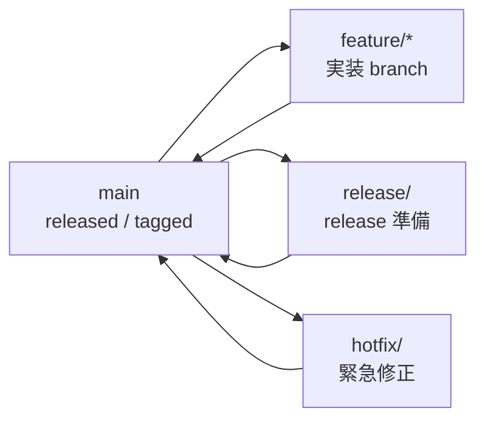

# Astars リリース戦略

関連文書:

- [STRATEGY.ja.md](STRATEGY.ja.md)
- [NEXT_RELEASE_PLAN.ja.md](NEXT_RELEASE_PLAN.ja.md)
- [ACTION_ITEMS.ja.md](ACTION_ITEMS.ja.md)

この文書は、Rust core(`crates/astars-core` + `bindings/python` + `bindings/node`)の branch strategy、versioning、publish 方針を定義する。

## Current State

PyPI の [`astars 0.1.0`](https://pypi.org/project/astars/) は、旧 Python-only 実装の最終 release である(詳細は `prototype-python/README.md`)。Rust core はまだ PyPI にも npm にも publish していない(build from source のみ)。publish 自動化(GitHub Actions 等)は未導入である。

## Goals

- Python wheel(`_astars`)と Node package(`@astars/native`)は、同じ version 番号で揃えて release する(tree-sitter や ast-grep と同様の Rust core + 複数言語 binding 構成を踏襲)
- `main` は release 済みの安定線にする
- feature branch は短命にする
- release 作業は `release/<version>` branch で行う
- 同じ version を再利用しない

## Branch Model



`feature/rust-core-migration` のような大きな branch も、作業単位が明確なうちは許容するが、1 release 分の作業が終わったら `main` に merge して閉じる。長寿命の branch を本線として使い続けない。

### `main`

- 直接作業しない
- publish する commit は `main` 上に存在する
- release tag は `main` に打つ
- `main` の HEAD は原則として `cargo build --workspace` / `cargo test --workspace` が通る状態にする

### `feature/*`

- `main` から切る
- scope を小さくする
- merge 後は削除する

### `release/<version>`

- `main` から切る
- `Cargo.toml` の `workspace.package.version`、`bindings/python/pyproject.toml`、`bindings/node/package.json` の version を揃える
- 新機能は原則追加しない
- release 完了後 `main` に merge し、tag を打つ

### `hotfix/<version>`

- `main` から切る
- release 済み version の緊急修正用
- 修正後 `main` に merge して patch release tag を打つ

## Versioning Policy

`MAJOR.MINOR.PATCH` を使う(crate は Cargo の semver、npm/PyPI もこれに合わせる)。

`v0.1.0`(旧 Python 実装)と `v0.2.0` 以降(Rust core)は別物だが、version 番号は同じ連番を引き継ぐ。`v0.x` の間は破壊的変更を許容する。

- `v0.2.0`: Rust core v0 scope(parse/query/edit primitive v1/diagnostics)を publish する最初の release。詳細は [NEXT_RELEASE_PLAN.ja.md](NEXT_RELEASE_PLAN.ja.md)
- `v0.3.0` 以降: 機能追加ごとに minor を上げる。何を入れるかは `NEXT_RELEASE_PLAN.ja.md` で都度決める
- `v1.0.0`: public API の安定宣言(時期未定)

`astars-core` / `astars-py` / `astars-node` の3 crate は、同じ version で揃える(個別バージョニングはしない)。`astars-core` 自体は crates.io に publish するかは未定 — 現時点では `bindings/*` からの path 依存で足りている。

## Tag Policy

```text
v0.2.0
v0.3.0
```

- tag は `main` に打つ
- publish は tag から行う
- tag と publish 先の version は一致させる

## Publish Policy

### Python(PyPI)

```bash
cd bindings/python
maturin build --release
# 検証後
maturin publish
```

### Node(npm)

```bash
cd bindings/node
npm run build  # napi build --platform --release
npm publish
```

publish 前に確認すること:

- `main` に release commit が merge されている
- release tag が打たれている
- clean checkout で `cargo build --workspace --release` が通る
- 両 binding の examples(`examples/python/basic_parse.py` / `examples/node/basic-parse.js`)が実際に動く
- 同じ version を再利用していない

GitHub Actions 等による publish 自動化は、`v0.2.0` 以降のどこかで導入を検討する(`NEXT_RELEASE_PLAN.ja.md` の候補には現時点で含めていない)。

## Do Not Do

- `main` で直接実装する
- 長寿命の branch を開発本線として使い続ける
- publish 済み version を再利用しようとする
- tag なしの commit から publish する
- code change と docs-only change を不必要に混ぜる

## Open Decisions

- GitHub Actions による publish 自動化をいつ導入するか
- `astars-core` を crates.io に publish するか
- `v1.0.0` の安定宣言条件
