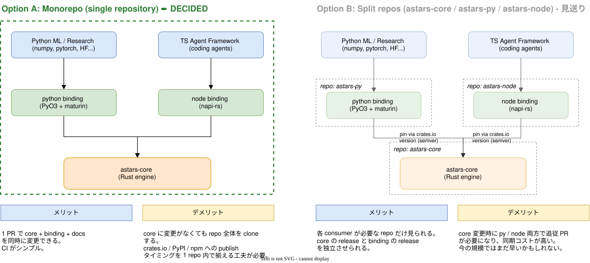
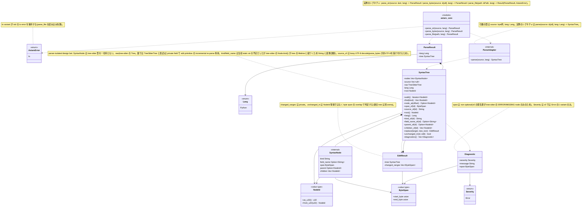
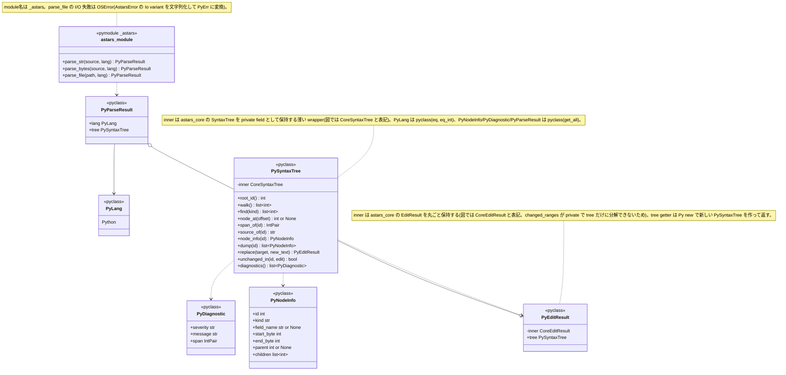
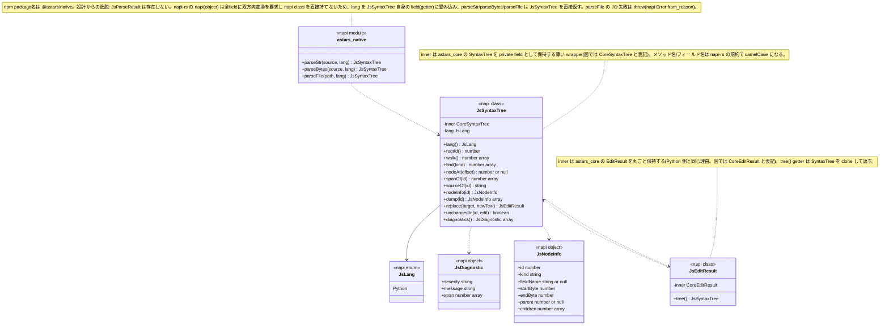
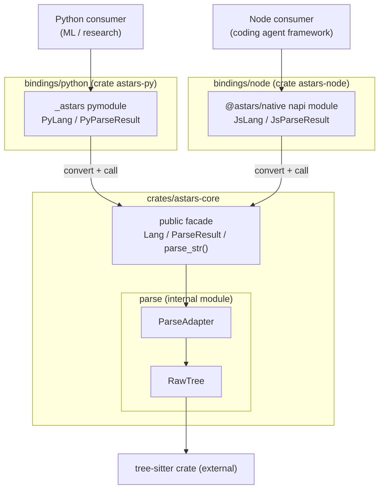

# Astars アーキテクチャ

ステータス: Rust core 実装中(v0 spike 段階)

関連文書:

- [STRATEGY.ja.md](../STRATEGY.ja.md)
- [ACTION_ITEMS.ja.md](../ACTION_ITEMS.ja.md)
- [API_STRATEGY.ja.md](../API_STRATEGY.ja.md)
- [CONCEPTS.ja.md](../CONCEPTS.ja.md)
- [EDIT_MODEL.ja.md](EDIT_MODEL.ja.md): 編集時のテキスト/木の追従モデル(v0 scope の AST node 構造設計の前提)

関連図:

#### repo-structure: monorepo 構成の決定(`.drawio.svg`。VS Code の draw.io 拡張で開くと編集できる)



#### astars-core: `SyntaxTree` / `SyntaxNode` データ構造 + 編集 primitive + Diagnostics のクラス図

> 2026-10-22、クラス図の表現を draw.io(`.drawio.svg`)から Mermaid(`classDiagram`、Markdown に直接埋め込み)に切り替えた。理由: (1) コード変更のたびに図を更新するコストが draw.io だと高く、実際に編集 primitive と `parse_bytes`/`parse_file`/Diagnostics の2ラウンド分、図の更新が漏れていた、(2) draw.io の VS Code 拡張でファイルを開くだけで background-color 等のメタデータ差分が git 上に出てしまう、(3) この文書は既に Mermaid の flowchart(Layer Overview)を使っており、レンダリング経路は実績がある。`repo-structure`(意思決定の記録図で、クラス図ではない)はそのまま draw.io に残す。



#### bindings/python(crate `astars-py`): `SyntaxTree` 公開 + 編集 primitive + Diagnostics のクラス図



#### bindings/node(crate `astars-node`): `SyntaxTree` 公開 + 編集 primitive + Diagnostics のクラス図



> 2026-05 〜 09 にかけて書かれていた旧版は、Python 実装(`astars/` package)を前提にした目標アーキテクチャだった。`STRATEGY.ja.md` で core engine の実装言語を Rust にする方針へ転換したため、本書はその旧版を置き換える形で Rust 構成向けに書き直している。旧 Python 実装は `prototype-python/` に frozen reference として残っており、そこで検証済みの設計判断(source mapping の挙動、tie-breaker 方針など)は `SOURCE_MAPPING_PLAN.ja.md` の Resolved Decisions を通じて引き継ぐ。

この文書は、Astars の概念モデルを実装上の crate / module boundary に落とすための文書である。現行コードをそのまま正当化する文書ではなく、`astars` engine として安定させるべき目標アーキテクチャを示す。

## Architecture Goals

Astars の architecture は、次の性質を満たすことを目指す。

- parser-specific API(tree-sitter)を core から隔離する
- binding-specific API(pyo3 / napi-rs)を core から隔離する — core は Rust だけに依存する
- source mapping を core value として扱う
- analysis-specific な判断を core に入れない
- downstream(Python ML research / Node agent framework)が依存しやすい小さな public API を持つ
- Python を reference 言語としつつ、他言語追加の余地を残す
- source-aware edit primitive を提供できる構造にする

## Repository Layout

monorepo 構成の決定は [repo-structure.drawio.svg](repo-structure.drawio.svg) を参照。実際に作成したディレクトリ構成は次の通り。

```text
astars/                      (repo root, Cargo workspace)
  Cargo.toml                 workspace manifest

  crates/
    astars-core/              parse / normalize / map / query / edit の core engine
      src/
        lib.rs                 public facade: Lang, ParseResult, parse_str()
        parse/                 internal module(非 pub。crate 外から不可視)
          mod.rs
          adapter.rs            ParseAdapter: tree-sitter を直接叩く唯一の場所
          raw_tree.rs           RawTree: tree_sitter::Tree を保持する internal struct

  bindings/
    python/                   crate `astars-py`、lib 名 `_astars`
      src/lib.rs               PyLang / PyParseResult(astars_core の mirror + convert)
      pyproject.toml           maturin build-backend
    node/                     crate `astars-node`、npm package `@astars/native`
      src/lib.rs               JsLang / JsParseResult(astars_core の mirror + convert)
      build.rs                 napi_build::setup()
      package.json              @napi-rs/cli

  prototype-python/          旧 Python 実装(frozen reference, 非 active development)

  docs/
    architecture/             本書 + draw.io 図
```

## Layer Overview

Astars は、概念的に次の layer に分ける。



依存方向は、consumer(Python/Node)から binding crate に向かい、binding crate は `astars-core` の public facade だけに依存する。`astars-core` 自身は pyo3 にも napi-rs にも依存しない(binding-agnostic)。tree-sitter への依存は `astars-core` 内の `parse`(internal module)に閉じ込められ、`astars-core` の public API にも、binding crate にも漏れない。

## Dependency Direction

原則:

- Python / Node consumer は、それぞれの binding crate(`astars-py` / `astars-node`)にのみ依存する
- binding crate は `astars-core` の public facade(`Lang`, `ParseResult`, `parse_str`)にのみ依存する
- binding crate は、FFI 境界を越えるための mirror 型(`PyLang`/`JsLang` など)と変換ロジック(`From` 実装)を自分で持つ
- `astars-core` は pyo3 / napi-rs のどちらにも依存しない
- `astars-core` の public facade は `parse`(internal module)の実装詳細(tree-sitter 型)に依存させない
- `astars-core` は downstream package(`astars-metrics` 等、将来)に依存しない

依存方向を逆流させないことと、tree-sitter / pyo3 / napi-rs という3種の外部依存をそれぞれの層に閉じ込めることが、Astars を軽量 engine として保つための重要な制約である。

## Module Responsibilities

### `astars-core`(public facade, `src/lib.rs`)

public API の入口を提供する。

責務:

- `Lang`(対象言語の列挙)を公開する
- `ParseResult`(正規化された parse 結果)を公開する
- `parse_str(source, lang) -> ParseResult` を公開する
- `parse`(internal module)の実装詳細を隠す

### `astars-core::parse`(internal module)

parser 固有の処理を閉じ込める。crate root で `pub` にしていないため、crate 外からは `ParseAdapter` / `RawTree` のどちらにも到達できない。

責務:

- `ParseAdapter`: tree-sitter の `Parser` / `Language` を直接扱う唯一の場所
- `RawTree`: `tree_sitter::Tree` と source bytes を保持する internal struct
- tree-sitter 型を `astars-core` の public facade に漏らさない

### `bindings/python`(crate `astars-py`)

Python 向け FFI 層。pyo3 に依存してよい唯一の crate。

責務:

- `PyLang` / `PyParseResult`: `astars_core::Lang` / `ParseResult` の mirror 型
- `From` による双方向変換(`PyLang <-> Lang`, `ParseResult -> PyParseResult`)
- `#[pymodule] fn _astars(...)`: Python から `import _astars` で使う entry point
- `astars-core` を呼び出す(`astars_core::parse_str` の呼び出し)

### `bindings/node`(crate `astars-node`)

Node 向け FFI 層。napi-rs に依存してよい唯一の crate。

責務:

- `JsLang` / `JsParseResult`: `astars_core::Lang` / `ParseResult` の mirror 型(`JsParseResult` は `#[napi(object)]` の plain object)
- `From` による双方向変換
- `#[napi] fn parse_str(...)`: Node から `parseStr`(napi-rs の camelCase 規約)として呼ばれる entry point
- `astars-core` を呼び出す

### `prototype-python/`(frozen reference)

旧 Python 実装。active development の対象ではないが、source mapping の挙動・edge case・tie-breaker 方針などの設計判断は、Rust 実装の参照として使う。詳細は [`prototype-python/README.md`](../../prototype-python/README.md)。

## Public / Extension / Internal Boundary

### Public(`astars-core`)

downstream(binding crate)が依存してよいもの:

- `Lang`
- `ParseResult`
- `parse_str(source, lang) -> ParseResult`

### Public(各 binding crate)

consumer(Python / Node)が依存してよいもの:

- Python: `_astars.PyLang`, `_astars.PyParseResult`, `_astars.parse_str`
- Node: `JsLang`, `JsParseResult`, `parseStr`(`@astars/native` から)

### Internal

安定 API として扱わないもの:

- `astars-core::parse::ParseAdapter` / `RawTree`(crate 外から到達不可)
- `tree_sitter::Parser` / `Tree` / `Node` などの tree-sitter 型
- pyo3 / napi-rs の型(binding crate の実装詳細)

## v0 Scope(Rust core)

旧 Python 実装の `0.1.0` 相当(`astars.parse_str` / `SourceUnit` / `SourceSpan` / `Diagnostic` / node interface / `walk` / `find` / `node_at` / `span_of` / `source_of`)に、Rust core として到達することを `v0` のゴールとする。

### 現状

- [x] `parse_str(source, lang) -> ParseResult { lang, tree: SyntaxTree }` — toolchain(tree-sitter + pyo3 + napi-rs)が繋がることの証明が目的だった最初の spike から、実際に動く `SyntaxTree` / `SyntaxNode` 構造に進んだ
- [x] `astars-core` が binding-agnostic であることをコードレベルで保証(`mod parse;` が非 `pub`。`SyntaxTree` は `tree_sitter::Tree` を private field に持つが、公開 API には一切出さない)
- [x] AST-like node 構造(上の「astars-core」クラス図、`NodeId` / `ByteSpan` / `SyntaxNode` / `SyntaxTree`)。v0 は tree-sitter の生 CST を 1:1 で使い、rule による正規化はまだ無い
- [x] `SyntaxGraph` 相当は不要と判断した(v0 は 1 raw node = 1 `SyntaxNode` なので span を node に直接持たせられる。rule 正規化を足すときに再検討する。詳細は [EDIT_MODEL.ja.md](EDIT_MODEL.ja.md))
- [x] query API(`walk`, `find(kind)`, `node_at(byte_offset)`, `span_of`, `source_of`)
- [x] `SyntaxTree` を Python / Node 両 binding に公開し、実際に動作確認済み(上の「bindings/python」/「bindings/node」クラス図。`examples/python/basic_parse.py` / `examples/node/basic-parse.js` で同一結果を再現)

### 残っている作業(v0 到達に必要)

優先順位を変更した(2026-10-22、`ACTION_ITEMS.ja.md` 参照): AWS Kiro の AST 構造化編集の公開を受け、編集 primitive を他の v0 残作業より先に進めた。以降のアイテムもすべて完了した。

- [x] **編集 primitive(v1)**: `SyntaxTree::replace` + `EditResult` + `unchanged_in`(設計は [EDIT_MODEL.ja.md](EDIT_MODEL.ja.md) の「編集 primitive(v1)の設計」)。Python / Node 両方に公開済み
- [x] `parse_bytes` / `parse_file` の追加(`ParseAdapter::parse` が `&[u8]` を受ける形に変更し、`parse_str` はその薄いラッパーにした。`parse_file` は `AstarsError::Io` を返す。非 UTF-8 encoding サポートは追加していない — 下記 Non-Goals 参照)
- [x] `SyntaxTree::source_of` の Unicode 境界対応(`&str` + `.expect()` で panic する実装から、`String::from_utf8_lossy` で U+FFFD 置換する実装に変更。byte offset 自体は常に正しいまま)
- [x] Diagnostics(`astars_core::Diagnostic` / `Severity` を新設し、`SyntaxTree::diagnostics()` で tree-sitter の `ERROR` / `MISSING` node を公開)

Python / Node 両 binding にも、`parse_bytes` / `parse_file` / `diagnostics()` を公開済み(`PyDiagnostic`/`JsDiagnostic` を追加)。

### Non-Goals(v0 では扱わない)

- ~~edit primitive の本格実装~~ → v1(`replace` + `unchanged_in` のみ)を前倒しすることにした。insert/delete 専用メソッド、Piece Table 化、系譜追跡(操作9)、名前/kind アドレス指定(操作10)は引き続き Non-Goal(詳細は `EDIT_MODEL.ja.md` の「v1 のスコープ外」)
- CST / `RawSyntaxNode` の stable public API 化
- semantic analysis
- Python 以外の対象言語
- `parse_file` の非 UTF-8 encoding サポート(Shift-JIS 等)。`encoding_rs` のような追加依存が必要になるため v0 では見送った
- `SourceSpan` の `start_point`/`end_point`(line/column)の public API 化。`replace` 内部の `point_at` helper はあるが非公開のまま

## Open Questions

- `SyntaxGraph` を `astars-core` 内の別 internal module にするか、`parse` module に含めるか(rule 正規化を足すタイミングで再検討)
- Python / Node 両方で同じ node id 安定性(stable ID)をどう保証するか
- 編集 primitive の v2(Piece Table 化、insert/delete、系譜追跡、名前/kind アドレス指定)をいつ着手するか
