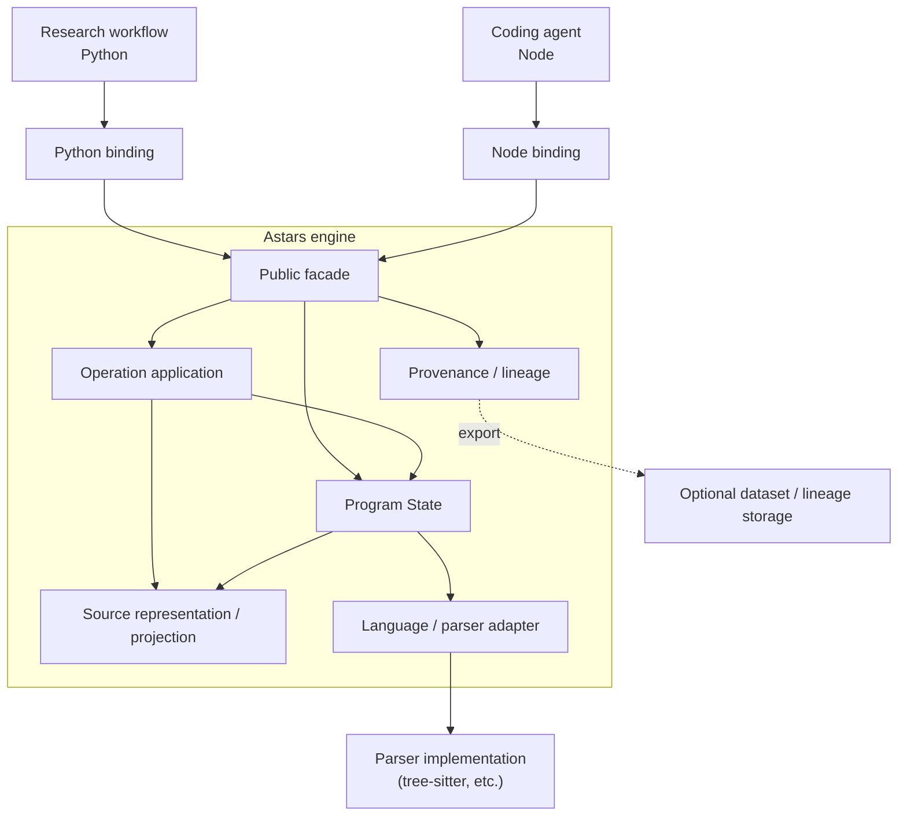
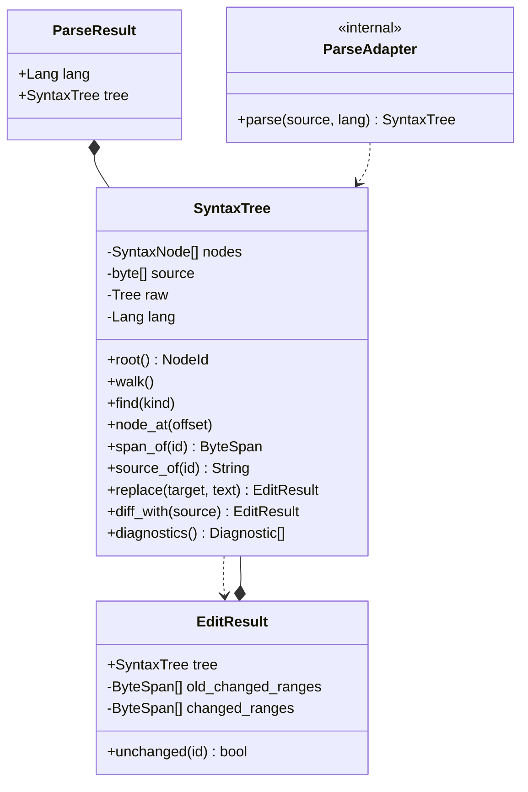

# Astars Architecture

ステータス: Draft

関連文書:

- [README.md](README.md)
- [PROGRAM_MODEL.ja.md](PROGRAM_MODEL.ja.md)
- [SOURCE_MODEL.ja.md](SOURCE_MODEL.ja.md)
- [OPERATION_MODEL.ja.md](OPERATION_MODEL.ja.md)
- [PROVENANCE_MODEL.ja.md](PROVENANCE_MODEL.ja.md)
- [../strategy/ROADMAP.ja.md](../strategy/ROADMAP.ja.md)

## この文書について

この文書は、Astarsのdesign modelを実装上のlayer、crate、module、bindingへどう配置するかを定義する。

Program State、source座標、operation、lineageの意味論は各model文書が所有する。本書ではそれらを再定義せず、依存方向、所有境界、現在の実装とtarget architectureの差を扱う。

## Architecture Goals

- Program State、Operation、Provenanceを独立した責務として発展させられる
- parser固有型をcoreのpublic APIへ漏らさない
- pyo3 / napi-rs固有型をRust coreへ持ち込まない
- Python研究workflowとNode coding-agent workflowが同じcore semanticsを利用する
- source-preservingなStage 2からgraph-nativeなStage 5へ段階的に拡張できる
- incomplete stateを例外的な失敗ではなく通常のstateとして流せる
- modelと実装の対応、および未実装箇所を明示できる

## Non-Goals

- model文書に属する意味論をcrate構成から逆算して決めること
- 現在のfile layoutを将来も固定すること
- parser / binding / storage実装を単一方式に固定すること
- analysis policy、variant生成戦略、similarity metricをcoreへ含めること
- Gitや一般的なVCSを置き換えること

## System Boundary

Astars engineは、program sourceをProgram Stateとして取り込み、structure queryとoperation適用を提供し、その派生関係を記録する。どのnodeを編集するか、生成variantをどう評価するかはconsumerが決める。



Storageはtargetの概念境界だけを示す。永続形式が必要になるまで、専用crateや`STORAGE_MODEL`を先に作らない。

## Target Layers

### Public Facade

consumerとbindingが依存する入口を提供する。

- parse / state creation
- structure query
- operation construction / application
- diagnostics
- lineage query / export

公開型はparser-neutralかつbinding-neutralでなければならない。各言語bindingはこの層の薄いmirror / wrapperに留める。

### Program State

[PROGRAM_MODEL.ja.md](PROGRAM_MODEL.ja.md)のProgram Stateとstructure layerを所有する。

- state snapshot
- syntax / normalized / editable structure
- state-local node identity
- incomplete / recovered stateの区別
- structure間mapping

最終的なRust module名はmodelが固まるまで確定しない。現在の`syntax` moduleを機械的に`state`へrenameすることも、この文書だけでは決めない。

### Source Representation / Projection

[SOURCE_MODEL.ja.md](SOURCE_MODEL.ja.md)のsource revision、byte coordinates、structure-to-source mappingを所有する。

- working source bytes
- encoding metadataとoriginal representationとの関係
- span / point / newline
- source-backed / source-unbacked element
- operation後のsource projection

text spliceと将来のstructural projectionが同じsource invariantsを共有する境界である。

### Operation Application

[OPERATION_MODEL.ja.md](OPERATION_MODEL.ja.md)のoperation lifecycleを実装する。

- target resolution
- precondition / validation
- state transition
- source projectionとre-parse
- application result
- replay / compositionに必要なoperation value

Stage 2ではstructure-addressed text editを扱い、Stage 5ではgraph-native operationを扱う。同じlayerであっても内部方式が同一である必要はない。

### Provenance / Lineage

[PROVENANCE_MODEL.ja.md](PROVENANCE_MODEL.ja.md)のstate / operation / node lineageを所有する。

- StateId / OperationId
- derivation DAG
- known operationによるnode relation
- inferred correspondenceとの区別
- deleted / inserted elementの追跡
- dataset再現用export

Stage 2の単発`EditResult`に全lineage責務を詰め込まない。lineageは複数state / operationを跨ぐ上位の文脈を必要とする。

### Language / Parser Adapter

parser固有処理を隔離する。

- language selection
- parse / incremental re-parse
- parser treeからsyntax structureへの変換
- parser recovery情報のdiagnostics化
- grammar field / kind情報の取り込み

tree-sitter型はこの境界より上のstable public APIに出さない。second languageを実装する時点でadapter contractを独立文書化する。

### Bindings

Python / Node固有のFFI表現、error変換、命名規約を所有する。

- core valueのwrapper / mirror
- language runtimeに適したcollection / optional表現
- exception / thrown errorへの変換
- package entry point

binding間で外形を完全一致させることより、core semanticsを一致させることを優先する。

## Dependency Rules

依存方向は次を原則とする。

```text
consumer
  -> binding
    -> core public facade
      -> model implementation layers
        -> parser adapter / external parser
```

- `astars-core`はpyo3 / napi-rsに依存しない
- Python bindingとNode bindingは互いに依存しない
- bindingはcoreのpublic APIだけを使用する
- parser adapterはbindingを知らない
- parser固有型はcore public APIとbindingへ漏らさない
- operationはconsumer固有のselection / evaluation policyへ依存しない
- provenanceは特定のsimilarity metricへ依存しない
- source layerは特定operation kindだけを前提にしない
- downstream packageや研究実験はcoreから参照しない

循環依存を避けるため、model間の共有valueは一方向の所有か小さな共通valueとして定義する。便宜のために巨大な`ProgramState` moduleへ全責務を集約しない。

## Target Ownership Map

以下は責務の割当であり、将来のfile名を確定するものではない。

| Design concept | Target owner | External boundary |
|---|---|---|
| Program State / structure / NodeId | core state layer | core public facade |
| source bytes / revision / span / projection | core source layer | parse input、file I/O |
| operation value / validation / application | core operation layer | consumer command |
| state / operation / node lineage | core provenance layerまたは上位workspace layer | dataset export |
| parse / incremental parse | internal language adapter | parser library |
| Python runtime representation | `bindings/python` | Python package |
| Node runtime representation | `bindings/node` | npm package |
| variant selection / evaluation | downstream research / agent code | Astars外 |

Provenanceを`astars-core`内部に置くか、複数stateを管理する別crateへ置くかは未決定である。単一stateのvalue modelとdataset全体のworkspace modelを分ける可能性がある。

## Current Implementation

現行Rust実装は[ROADMAP.ja.md](../strategy/ROADMAP.ja.md)のStage 2を部分的に実装している。

```text
crates/astars-core/src/
  lib.rs
  diagnostics.rs
  syntax.rs
  parse/
    mod.rs
    adapter.rs

bindings/python/src/lib.rs
bindings/node/src/lib.rs

prototype-python/
  frozen reference implementation
```

### `astars-core`

現在のpublic API:

- `Lang`
- `ParseResult`
- `SyntaxTree`
- `NodeId`, `ByteSpan`, `Point`
- `EditResult`
- `Diagnostic`, `Severity`
- `AstarsError`
- `parse_str`, `parse_bytes`, `parse_file`

`syntax.rs`は現在、Program Stateの一部、source representation、query、text edit、incremental parse coordinationをまとめて担っている。Stage 2の小さな実装としては成立しているが、target model上は複数責務に跨る。

`parse`はprivate moduleであり、`ParseAdapter`と`parser_for`をcrate内だけへ公開する。`tree_sitter::Tree`は`SyntaxTree`のprivate fieldとしてincremental re-parseに使われ、public APIには現れない。



`replace`はtarget nodeのspanをtext spliceし、tree-sitterのincremental parseを用いて新しい`SyntaxTree`を返す。`diff_with`はline diffから複数text editを作り、二sourceのchanged rangeを得る。どちらもnode correspondenceや永続lineageを生成しない。

### Python Binding

`bindings/python`はpyo3 wrapperとして次を公開する。

- `PyLang`, `PyParseResult`, `PySyntaxTree`
- `PyNodeInfo`, `PyDiagnostic`, `PyEditResult`
- `parse_str`, `parse_bytes`, `parse_file`

`PySyntaxTree` / `PyEditResult`はcore valueをprivate fieldに保持する。tree dumpのbulk exportを持つが、model semanticsはcore側に委譲する。

### Node Binding

`bindings/node`はnapi-rs wrapperとして次を公開する。

- `JsLang`, `JsSyntaxTree`
- `JsNodeInfo`, `JsDiagnostic`, `JsEditResult`
- `parseStr`, `parseBytes`, `parseFile`

Node側には`JsParseResult`がない。napi-rsの表現制約から、`lang`を`JsSyntaxTree`のgetterとして持ち、parse関数はtreeを直接返す。この外形差はbinding concernであり、coreのProgram Model差ではない。

### Frozen Python Prototype

`prototype-python/`はactive implementationではなく、旧研究実装の設計判断とedge caseを参照するために保持する。新機能を二重実装する場所にはしない。

## Target / Current Gap

| Target capability | Current implementation | Gap |
|---|---|---|
| Program State snapshot | `ParseResult` + `SyntaxTree` | state identity、revision、明示的validityがない |
| structure layers | tree-sitter CST由来の単一`SyntaxTree` | normalized structure / editable graph / layer mappingがない |
| source revision | `Vec<u8>`を`SyntaxTree`が保持 | encoding metadata、original representation、revision identityがない |
| structure-addressed operation | `SyntaxTree::replace(NodeId, text)` | operation value、precondition、失敗結果、serializationがない |
| multi-edit application | `diff_with`内部でtext hunksを適用 | first-class operation sequence / compositionではない |
| incomplete state | parser recovery treeとdiagnostics | edit-derived absenceとparser recoveryを区別しない |
| provenance | old/new changed rangesと`unchanged` | StateId / OperationId / lineage DAG / node relationがない |
| structural correspondence | byte-range非重複によるunchanged判定 | move / rename / split / mergeを表現しない |
| source projection | text splice後にre-parse | source-unbacked graphからのprojectionがない |
| language abstraction | `Lang::Python`とprivate adapter | adapter contractとsecond language検証がない |
| binding parity | core query / editのthin wrapper | operation / provenance APIが未設計 |

## Evolution by Roadmap Stage

### Stage 2: Structure-Addressed Source Edit

現行構成を壊さず、次を明示的なvalueへ寄せる。

- source revision
- operation input / target / result
- validation error
- edit-derived state transition
- current `replace` semanticsのtestable contract

この段階ではtext splice + re-parseを維持してよい。

### Stage 3: First-Class Structural Edit Operations

- operation serialization / replay
- structural targetとpayloadの明示
- operation preconditionとvalidation result
- sequential operation sequence
- source patchとstructural intentの区別

Stage 2のvariant生成をoperation objectの列として記録し、同じoriginへ再適用できることを検証する。永続lineage graphはまだ導入しない。

### Stage 4: Variant and Lineage Model

- StateId / OperationId
- lineage DAG
- known node relation
- deleted element record
- sequential editとoriginからのindependent branch
- independent trees間のinferred correspondenceとの統合境界

複数stateを管理するworkspace境界をこの段階で確定する。

### Stage 5: Graph-Native Transformation and Incomplete States

- source-unbacked / inactive / placeholder elementを持つeditable graph
- incomplete graph operation
- graphからsourceへのprojection
- parser tree / normalized structure / editable graph間mapping

Stage 5の型をStage 2へ前倒しで固定せず、Stage 2で必要なidentityとoperation contractが後から拡張可能かを検証する。

## Public / Internal Boundary

### Stable候補

- parser-neutralなstate / structure query
- source coordinate value
- explicit operation value / result
- diagnostics
- provenance query value

### Internalに保つもの

- tree-sitterの`Parser`, `Tree`, `Node`, `InputEdit`
- arena layoutやnode storage方式
- incremental parseの最適化
- diff / matching algorithmの具体実装
- pyo3 / napi-rsの型
- graph projectionの中間表現

型がpublicであることと、永続serialization formatがstableであることは区別する。研究datasetの再現に必要なformatは、Stage 3以降にversioningを含めて決める。

## Architectural Invariants

- core public valueからparser libraryの型へ到達できない
- core semanticsはbindingごとに再実装しない
- operation適用はinput stateを破壊せず、新しいstateを生成する
- incomplete stateも通常のstate pipelineを通る
- known operation lineageとinferred diffを同一の確実性として扱わない
- node identityのscopeをbinding都合で拡張しない
- source coordinateは常にどのsource revisionに対するものか解釈できる
- analysis / evaluation policyをcore dependencyへ逆流させない

## Open Questions

- Program Stateを`ParseResult`の発展形にするか、新しい型として導入するか
- source layerを`syntax`から分離する最初の単位は何か
- first-class Operationをenum、trait、data schemaのどれから始めるか
- multi-state Provenance Graphを`astars-core`が所有するか、別crate / workspace layerへ置くか
- normalized structureをStage 3以前に導入する必要があるか
- Python / Node bindingでoperation serialization形式を共有するか
- public API stabilityと研究用experimental APIをどう分けるか

これらの決定は実装着手時にADRへ記録し、model文書には決定後の規約だけを反映する。
