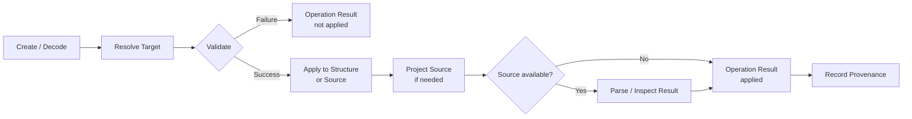
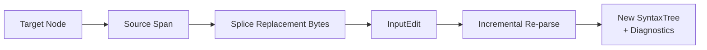
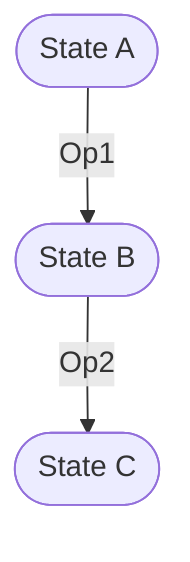
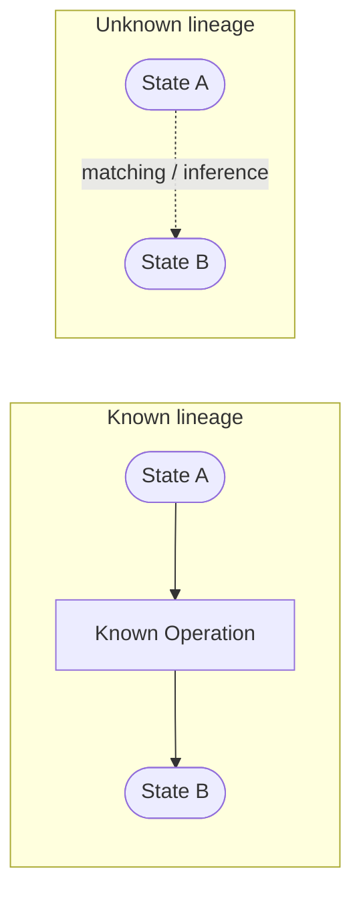

# Astars Operation Model

ステータス: Draft

関連文書:

- [README.md](README.md)
- [PROGRAM_MODEL.ja.md](PROGRAM_MODEL.ja.md)
- [SOURCE_MODEL.ja.md](SOURCE_MODEL.ja.md)
- [../strategy/USE_CASES.ja.md](../strategy/USE_CASES.ja.md)
- [decisions/0002-stage-2-source-splice-and-incremental-reparse.ja.md](decisions/0002-stage-2-source-splice-and-incremental-reparse.ja.md)
- [decisions/0004-independent-source-diff-is-inferred.ja.md](decisions/0004-independent-source-diff-is-inferred.ja.md)

## この文書について

この文書は、Astarsがprogram structureに対するoperationをどのように表現し、検証し、Program Stateへ適用するかを定義する。

operationは単発method callの副作用ではなく、保存・説明・再生・比較できるfirst-class valueへ発展させる。variant graphやnode lineageは`PROVENANCE_MODEL`、source bytesへのprojectionは[SOURCE_MODEL.ja.md](SOURCE_MODEL.ja.md)で扱う。

## Goals

- program structureを基準に編集対象を指定する
- operationの意図とsource patchを区別する
- operationを適用前に検証する
- parent stateを破壊せずnew stateを生成する
- valid / incompleteの両結果を保持する
- operationとresult state / diagnosticsを対応づける
- operationを保存・replayできる方向へ発展させる
- research workflowとLLM workflowで同じoperation modelを共有する

## Non-Goals

- どのoperationを選ぶべきかというpolicy
- pruning order、refactoring recipe、LLM promptの定義
- operation後programのsemantic correctness保証
- arbitrary malformed sourceからoperationを推定すること
- 独立した二木からedit scriptを推定するstructural diff
- Stage 3で全graph transformationを一度に実装すること

## Operationとは何か

Operationは、特定のProgram Stateまたはそのstructureを対象に、別のProgram Stateを生成するための明示的な変更記述である。

概念的には次を持つ。

```text
Operation
  ├─ Kind
  ├─ Input State Reference
  ├─ Target
  ├─ Payload
  ├─ Preconditions
  └─ Metadata
```

Rustやbindingでこの単一型をそのまま公開することは現時点で要求しない。

### Kind

operationの意味を表す。

段階ごとの候補:

| Stage | Operation例                | 対象                          | Payload            |
| ----- | -------------------------- | ----------------------------- | ------------------ |
| 2     | ReplaceSource              | node span                     | text / bytes       |
| 2     | DeleteSource               | node span                     | empty bytes        |
| 3     | InsertBefore / InsertAfter | node relation                 | text / bytes       |
| 3     | ReplaceNodeText            | structural target             | text / bytes       |
| 5     | InsertNode                 | parent / sibling relation     | structural node    |
| 5     | DeleteNode                 | structural node               | none               |
| 5     | UpdateNode                 | structural node               | structural payload |
| 5     | MoveSubtree                | source + destination relation | none               |
| 5     | GraftSubtree               | destination relation          | external subtree   |

この表は実装予定APIを確定するものではない。reference workflowで必要性を確認したoperationだけを追加する。

### Input State Reference

operationは、どのstateを前提に作られたかを識別する。

state referenceなしでtree-local NodeIdだけを保存すると、別stateへ誤適用できてしまう。少なくとも適用時にtargetがinput stateへ属することを検証する。

StateIdの具体形式は`PROGRAM_MODEL` / `PROVENANCE_MODEL`で決める。

### Target

operation対象を示す。

target表現には異なる段階がある。

1. **State-local NodeId**
   - 現在のtree内では明確
   - serialize後や別stateでは安定しない
2. **Node + Relation**
   - `before(node)`、`after(node)`、`first_child(parent)`等
   - insertion positionをbyte offsetより構造的に表す
3. **Structural Address**
   - kind、field、name、ancestor等の条件
   - 複数候補・候補なしを扱う必要がある
4. **Origin / Lineage Reference**
   - variantをまたいでorigin nodeを参照する
   - provenance modelが必要

selector DSLはtarget modelの一実装候補であり、先に導入しない。

### Payload

operationで挿入・置換する内容。

- source text / bytes
- source fragment + language
- structural node description
- existing subtree reference
- external subtree snapshot

text payloadはstructure-addressed source edit、structural payloadはgraph-native editに対応する。両者を同じものとして扱わない。

### Preconditions

operation作成時に期待したstate条件。

候補:

- input state identity
- target node kind / field
- expected source slice / hash
- expected parent relation
- target uniqueness
- language

preconditionはstale operationや誤target適用を検出するために使う。どこまで必須にするかはStage 3のreplay実証から決める。

## Operation Lifecycle

operationは次のpipelineを通る。



### 1. Create / Decode

API call、serialized data、LLM tool output等からoperation valueを得る。

この段階ではoperationが適用可能とは限らない。

### 2. Resolve Target

target expressionをinput state内の具体的node / relationへ解決する。

結果は少なくとも次を区別する。

- exactly one target
- no target
- ambiguous targets
- target belongs to another state
- stale target

最初の候補をsilentに選ばない。

### 3. Validate

operationを適用する前に検証する。

検証例:

- state / language一致
- targetの存在とownership
- operation kindがtarget relationに適用可能か
- source spanがrevision内にあるか
- payload encoding
- precondition一致
- move先が自分のdescendantではない等のgraph constraint

validation failureはProgram Stateを変更せず、制御されたerror / resultとして返す。

### 4. Apply

Stageに応じて異なるbackendを使う。

- Stage 2: source bytes splice
- Stage 3: relation-aware localized source edit
- Stage 5: editable program graph transformation

適用はinput stateを破壊せず、新しいcandidate stateを生成する。

### 5. Project Source

graph operationの場合、必要に応じてstructureをsourceへ投影する。

投影不能でもgraph stateとoperation recordを破棄しない。詳細は[SOURCE_MODEL.ja.md](SOURCE_MODEL.ja.md)を参照。

### 6. Parse / Inspect Result

sourceが得られた場合、再parseしてsyntax structureとdiagnosticsを得る。

diagnosticがあることはoperation application自体の失敗と同義ではない。研究用途ではincomplete resultが意図した結果の場合がある。

### 7. Produce Operation Result

概念的な結果:

```text
Operation Result
  ├─ Operation
  ├─ Input State
  ├─ Output State (if applied)
  ├─ Resolved Target
  ├─ Validation Facts
  ├─ Diagnostics
  ├─ Source Projection Status
  └─ Correspondence / Change Facts
```

### 8. Record Provenance

成功したoperationとoutput stateの関係をlineageへ記録する。validation failureをlineage eventとして残すかはprovenance modelで決める。

## Operation Success Semantics

「operationが成功した」と「結果programがvalidである」を分離する。

| Application | Source Projection | Parse           | 意味                                     |
| ----------- | ----------------- | --------------- | ---------------------------------------- |
| failure     | not attempted     | not attempted   | operationを適用できなかった              |
| success     | success           | clean           | complete result                          |
| success     | success           | diagnosticsあり | source化されたincomplete result          |
| success     | unavailable       | not attempted   | graph上のみ存在するresult                |
| success     | failure           | not attempted   | graph editは成立したがsource投影できない |

研究workflowでは後半の状態もデータとして保持する。

## Structure-Addressed Text Edit

現行Stage 2の中心operation。



長所:

- 現在のCST/source mappingを活用できる
- surrounding textを保持しやすい
- small public APIで実用的な編集ができる

制約:

- payloadは構造ではなくtext
- indentation / separatorをpayload側が知る必要がある
- target nodeが消えた事実以外のprovenanceが弱い
- zero-width insertionの意味論がspan overlapだけでは不十分
- operation replayにtree-local NodeIdをそのまま使えない

## Relative Source Operation

Stage 3への橋渡しとして、node relationから挿入位置を解決するoperationを検討する。

例:

- before statement
- after statement
- first / last child of body
- replace field

これはまだtext payloadを使うが、呼び出し側がbyte offset、改行、indentationを直接組み立てる責務を減らす。

どのrelationをgenericに提供できるかはPython reference workflowで実証する。

## Graph-Native Operation

Stage 5ではsource spanではなくprogram graphを直接変更する。

必要となる性質:

- parent/child/field constraint
- node ownership
- subtree cycle prevention
- source-backed / source-unbacked node
- placeholder / missing relation
- source projection
- operation composition

graph editが成立してもlanguage syntaxとしてcompleteとは限らない。不完全状態を明示的に表現できることが要件である。

## Replay

operationを保存し、同じ前提stateへ再適用して同じresultを得られることを目指す。

replayには少なくとも次が必要となる。

- operation serialization
- input state / revisionの識別
- targetの再解決
- precondition検証
- deterministic application
- projection規約

「同じresult」は、source bytes一致、structure一致、operation semantics一致のどれを要求するかで異なる。Stage 3でreference workflowに合わせて定義する。

## Composition

複数operationをsequenceとして適用する。



Op2はState Bを前提とするため、単純にOp1と交換できるとは限らない。

将来検討する性質:

- sequential composition
- independent operation batch
- conflict detection
- normalization / squashing
- inverse operation
- transaction-like all-or-nothing apply

初期Stageではsequential compositionのみを基準にし、一般的なoperation algebraを先に作らない。

## Relation to Structural Diff

既知operationの適用と、独立した二stateからoperationを推定するdiffを区別する。



`diff_with`は後者をline-based changed rangeで近似する現行機能である。GumTree型matchingは`PROVENANCE_MODEL`で、unknown lineage間のcorrespondence推定として扱う。

## Operation Invariants

1. operationはinput stateを明示または検証可能にする
2. state-local targetを別stateへsilentに適用しない
3. ambiguous targetを自動的に一件へ縮退させない
4. validation failureでinput stateを変更しない
5. operation applicationはparent stateを破壊しない
6. application successとsyntax / semantic validityを分離する
7. diagnostic付きoutput stateを保持できる
8. text payloadとstructural payloadを区別する
9. source projection failureでoperationとgraph stateを失わない
10. known operationとdiffから推定したoperationを区別する

## Current Stage

現在のRust coreは次を実装している。

- `SyntaxTree::replace(NodeId, &str) -> EditResult`
- `SyntaxTree::diff_with(&[u8]) -> EditResult`
- source splice + incremental re-parse
- old / new changed range
- `unchanged_in` / `unchanged`によるbyte-range overlap判定
- Python / Node bindingへのmirror API

現在の`EditResult`はoperation valueを保持せず、treeとchange rangeを持つ。target ownership、operation serialization、replay、lineageは未実装である。

## Known Gaps

- operation kind / payload / preconditionを値として保持しない
- input state identityがない
- NodeIdがforeign / staleか検証できない
- target addressingがbinding側の手続き的な`find + field + source`に分散する
- relative insertion APIがない
- application successとresult validityの型上の区別がない
- edit resultがdeleted node provenanceを持たない
- operation replay / serializationがない
- graph-native operationがない
- `diff_with`がoperation modelと同じ`EditResult`を使い、known editとinferred diffの意味が曖昧

## Open Questions

- Stage 3の最小operation集合を何にするか
- Operation / OperationResultを単一enumにするかlayer別型へ分けるか
- input state identityとpreconditionをどこまで必須にするか
- target addressをserialize可能にする最小形式は何か
- indentation / separator解決をoperation modelとsource projectionのどちらが持つか
- incomplete resultをsuccessとして返すAPIをどう表現するか
- replayの同一性をbytes / structure / semanticsのどこで定義するか
- operationのinverseをcore要件にするか
- batch / transaction semanticsをいつ導入するか
