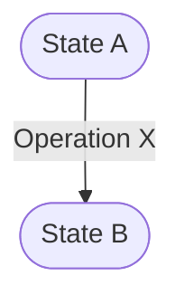
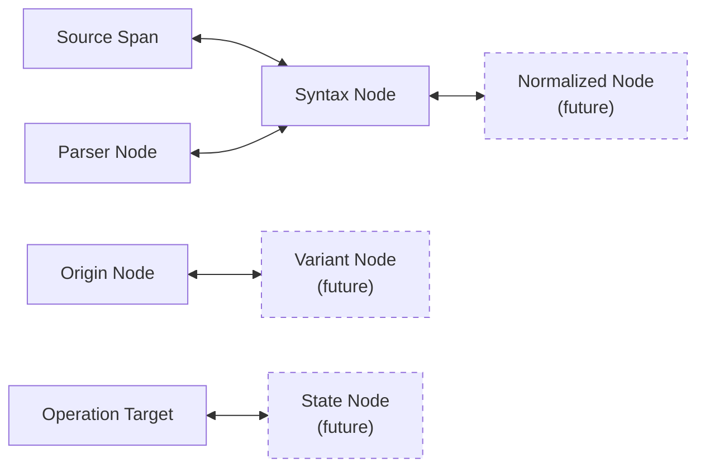
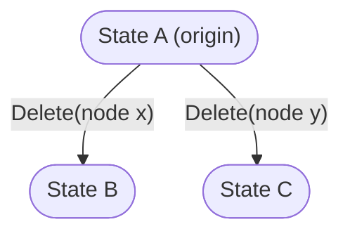
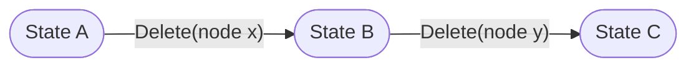

# Astars Program Model

ステータス: Draft

関連文書:

- [README.md](README.md)
- [../strategy/STRATEGY.ja.md](../strategy/STRATEGY.ja.md)
- [../strategy/USE_CASES.ja.md](../strategy/USE_CASES.ja.md)
- [../strategy/ROADMAP.ja.md](../strategy/ROADMAP.ja.md)

## この文書について

この文書は、Astars が program をどのような state / structure として扱うかを定義する。sourceのencodingや座標は`SOURCE_MODEL`、operationの意味論は`OPERATION_MODEL`、state間の派生関係は`PROVENANCE_MODEL`で扱う。

具体的なRust型やbinding APIを先に固定することが目的ではない。現在の`SyntaxTree`、将来のnormalized AST、編集可能なprogram graphを評価するための共通概念と不変条件を定める。

## Goals

Program Modelは次を可能にする。

- parser固有objectを公開せずにprogram structureを観測する
- nodeとsource representationを対応づける
- validな完成済みprogramと、編集由来のincomplete stateを扱う
- operation適用前後のstateを区別する
- node identityの有効範囲を明確にする
- 削除・置換された要素の由来を後続のprovenance modelで保持できるようにする
- 現在のCST arenaからgraph-native transformationへ段階的に発展できるようにする

## Non-Goals

Program Modelは次を保証しない。

- 型・symbol・data-flow等の完全なsemantic model
- programのコンパイル成功や実行時の正しさ
- 特定研究のpruning / mutation policy
- parserが復元できない外部sourceの編集意図の推定
- 全言語の構文差を消した単一universal AST

## 中心概念

### Program State

Program Stateは、ある時点のprogramをAstarsが観測・操作するための概念上のsnapshotである。

Program Stateは少なくとも次の側面を持つ。

```text
Program State
  ├─ Language
  ├─ Source Representation
  ├─ Structural Representation
  ├─ Source <-> Structure Mapping
  ├─ Diagnostics / Validity Facts
  └─ Provenance Reference
```

すべてのstateが、すべての側面を完全に持つとは限らない。

- parserから得た通常stateはsourceとsyntax structureを持つ
- graph-native edit途中のstateはsourceへ完全投影できない可能性がある
- sourceだけを外部から受け取った時点ではstructureがまだ構築されていない
- provenanceを持たない独立sourceも入力できる

公開APIで単一の`ProgramState`型にするか、複数型に分けるかは未決定とする。

### State Snapshot

Program Stateは概念上immutableなsnapshotとして扱う。operation適用は既存stateを破壊せず、新しいstateを生成する。



この性質により、次を可能にする。

- 同じoriginから独立したvariantを生成する
- sequential editの各途中状態を保持する
- before / afterを同時に比較する
- operationのreplayと再現性を検証する

内部実装でcopy-on-write、persistent data structure、mutable builderを使うことは妨げない。外部から観測されるstate identityを、暗黙のin-place mutationで変化させないことが要件である。

### Language

各Program Stateは、そのstructureとsourceを解釈する対象言語を明示する。

Languageはparser実装そのものではない。例えば`Python`という言語指定と、tree-sitter-pythonというparser adapterは別概念である。

## Structural Representation

Astarsでは、異なる目的を持つstructure layerを区別する。

### Parser Tree

parserが生成する生の構文木。tree-sitterを使う場合は`tree_sitter::Tree` / `Node`に相当する。

- parser固有
- incremental parseやrecovery情報を持つ
- public stable modelとはしない

### Syntax Structure

parser treeをAstars-ownedなnode arena / graphへ写した構造。

- node kind
- field name
- parent / children
- source span
- parser originとの内部対応

現在のRust実装の`SyntaxTree`はこのlayerに相当し、tree-sitter CSTをほぼ1:1で写している。

### Normalized Program Structure

分析・operationで使いやすいよう、parser固有の細部を必要な範囲で正規化した構造。将来候補であり、現時点ではRust coreに実装されていない。

normalizationの目的は全言語差を消すことではない。複数adapterに共通するoperation contractを定義し、downstreamがparser固有objectへ依存しないための境界を作ることである。

### Editable Program Graph

graph-native transformation、incomplete state、削除placeholder、sourceへ未投影のnode等を扱う将来の構造。

次の実装方式を現時点では確定しない。

- normalized structure自体をeditableにする
- immutable base treeへoperation overlayを重ねる
- active nodeとtombstoneを含む別graphを持つ
- Extended ASTとしてgrammarを拡張する

どの方式でも、この文書のidentity・validity・mappingの規約を満たす必要がある。

## Node Model

### Node

Nodeは、あるProgram State内のprogram structure要素である。

nodeが持ち得る情報:

- local identity
- kind / role
- parent / children / field
- source mapping
- parser origin
- active / missing / deleted等の状態
- provenance reference

すべてのlayerで同じnode型を使うことは要求しない。parser tree node、syntax node、normalized node、editable graph nodeは別型になり得る。

### Node Identity Scope

node identityは、少なくとも次のscopeを区別する。

1. **Tree-local identity**
   - 単一のstructure snapshot内でnodeを特定する
   - 現行`NodeId(u32)`はこれに相当する
2. **State-local identity**
   - Program State内の特定layerとnodeを特定する
3. **Cross-state correspondence**
   - 異なるstateのnodeが同じoriginを持つ、またはoperationで対応することを示す
   - local IDの数値一致では表現しない
4. **Lineage identity / origin reference**
   - variant群をまたいで由来を問い合わせる
   - `PROVENANCE_MODEL`で定義する

現行`NodeId`を別treeへ渡しても意味はない。public APIは、foreign / stale / out-of-range IDをpanicではなく制御されたerrorとして扱う。

### Active and Non-Active Elements

通常のsyntax treeは、現在のsourceに存在するactive nodeを中心に表現する。

将来のeditable graphでは、次の要素も必要になり得る。

- operationによって削除されたnode
- sourceへ未投影の挿入node
- 必須要素が欠けていることを示すplaceholder
- node間の削除されたedge

これらをactive treeへ含めるか、provenance graphへ分離するかは未決定とする。ただし、削除と同時にorigin情報を失う設計は採用しない。

## Validity Model

### Validityは単一の真偽値ではない

Program Stateの「正しさ」を一つの`valid: bool`へ集約しない。少なくとも次を区別する。

- source bytesとして保持可能
- parserがtreeを生成した
- parser recovery diagnosticがない
- 対象言語のsyntax上妥当
- compiler / interpreterが受理する
- semantic上妥当
- downstreamの評価条件を満たす

Astars coreが直接観測できるのは主にsource、parse result、parser diagnostics、operation validationである。compile / semantic / experiment評価は外部factとして関連づけられるが、coreが判定しない。

### Complete State

対象言語の通常構文としてparseでき、Astarsが必要なstructureとsource mappingを構築できるstate。

`diagnostics().is_empty()`だけでsemantic validityまで保証しない。

### Recovered State

外部sourceにsyntax error等があり、parser recoveryを通じてstructureを得たstate。

- sourceは存在する
- parser recovery node / diagnosticを持つ
- どの編集によって壊れたかは不明な場合がある

### Edit-Derived Incomplete State

Astarsが把握するoperationにより、構造要素が欠落・未完成になったstate。

- origin stateとoperationを知っている
- parser recovery結果とoperation provenanceを区別して保持する
- sourceへ投影できる場合と、graph上でのみ表現できる場合がある
- compile不能でもProgram Stateとして保持できる

このstateがAstarsの最終像における中心的な対象である。

## Diagnostics and Facts

DiagnosticはProgram Stateについて観測されたfactであり、stateそのものを無効化して破棄する理由ではない。

diagnosticの例:

- parser recovery error
- missing syntax element
- operation target error
- source projection failure
- external compiler result

parser diagnosticとoperation validation errorは発生源が異なるため、将来同じ型へ統合する場合もsource/categoryを識別できるようにする。

## Mapping Requirements

Program Modelは、利用可能なlayer間でmappingを明示する。



mappingは常に1対1とは限らない。

- 複数のraw nodeが一つのnormalized nodeになる
- 一つのoperationが複数node / edgeへ影響する
- deleted nodeは新stateにactive counterpartを持たない
- inserted nodeはold stateにcounterpartを持たない

covering spanだけでmappingを代表させると情報を失う場合があるため、normalized layer導入時にmany-to-many mappingを再検討する。

## State Invariants

Target Modelは次を満たす。

1. すべてのactive nodeは、所属するstateとstructure layerを一意に特定できる
2. local node IDは、所属state / treeの外で比較可能なidentityとして扱わない
3. source-backed nodeのspanは、そのstateのsource coordinate systemで解釈される
4. sourceを持たないnodeは、偽のspanを持たず「未投影」を表現できる
5. diagnosticが存在してもstateを保持・観測できる
6. edit-derived incomplete stateは、少なくともorigin operationを辿れる
7. operation適用はparent stateを暗黙に書き換えない
8. parser recoveryから推測した情報と、既知operationから得たprovenanceを混同しない
9. 削除された要素のoriginを、active treeから消えたことだけを理由に失わない

## Example State Transitions

### Independent Variants



State BとState Cは別のsnapshotであり、どちらもState Aを変更しない。

### Sequential Variant



State Cのdirect parentはState B、originはState Aである。この関係の厳密な表現は`PROVENANCE_MODEL`で定義する。

### Incomplete State

```text
State A: assignment(left=sum, right=value)
  -- Delete(right) -->
State B: assignment(left=sum, right=<missing>)
```

source projectionが`sum =`を生成する場合でも、State Bは単なる壊れた文字列ではなく、既知operationから派生したstateとして扱う。

## Current Stage

現在のRust coreは次を実装している。

- `SyntaxTree`がsource bytes、tree-sitter tree、languageを保持する
- tree-sitter CSTを`SyntaxNode` arenaへ1:1で写す
- `NodeId(u32)`をtree-local indexとして使う
- node kind、field、parent、children、spanを保持する
- parser diagnosticsをtree-sitter recovery nodeから得る
- `replace` / `diff_with`が新しい`SyntaxTree`を生成する

現在の実装はProgram Stateの一部を`SyntaxTree`と`EditResult`へ分散して表現している。明示的なStateId、operation value、node provenance、variant graphは持たない。

## Known Gaps

- `SyntaxTree`とProgram Stateの責務境界が未定義
- CSTとnormalized structureのlayerが分離されていない
- invalid / foreign NodeIdがpanicになり得る
- node correspondenceをbyte-range overlapで近似している
- deleted nodeのprovenanceを保持しない
- edit-derived incomplete stateと外部syntax errorを区別しない
- sourceを持たないstructural nodeを表現できない
- operation適用前後のstate identityを持たない

## Open Questions

- public APIで`ProgramState`を一型にするか、parse state / editable state等へ分けるか
- normalized structureをいつ導入するか
- incomplete elementをplaceholder node、missing edge、operation overlayのどれで表現するか
- StateIdをcontent-derived、session-local、persistentのどれにするか
- active structureとprovenance graphを同じarenaに置くか分離するか
- external compiler / evaluatorのfactをcore modelへどう関連づけるか
- state snapshotのserializationをどのstageで安定化するか
