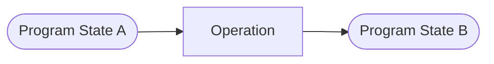
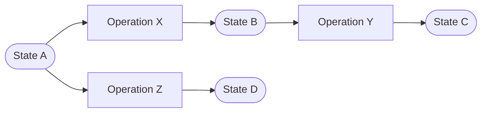
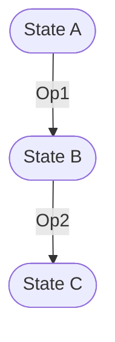
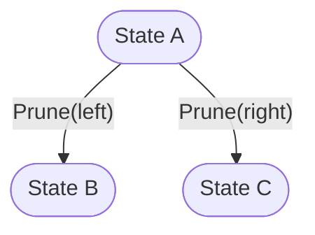
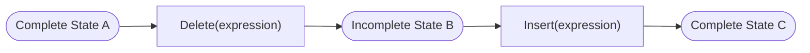

# Astars Provenance Model

ステータス: Draft

関連文書:

- [README.md](README.md)
- [PROGRAM_MODEL.ja.md](PROGRAM_MODEL.ja.md)
- [OPERATION_MODEL.ja.md](OPERATION_MODEL.ja.md)
- [../strategy/USE_CASES.ja.md](../strategy/USE_CASES.ja.md)

## この文書について

この文書は、Program State、operation、nodeの派生関係をどのように保持し、問い合わせるかを定義する。

既知operationによって生成されたvariant lineageと、由来の分からない独立した二state間で推定するstructural correspondenceを区別する。operation自体の適用規約は[OPERATION_MODEL.ja.md](OPERATION_MODEL.ja.md)、stateとnodeの基本概念は[PROGRAM_MODEL.ja.md](PROGRAM_MODEL.ja.md)で扱う。

## Goals

- variantがどのstateとoperationから派生したかを辿れる
- sequential editとindependent variantを同じmodelで区別する
- origin nodeが各variantでどうなったかを問い合わせられる
- deleted / inserted / replaced / moved nodeの由来を失わない
- incomplete stateをlineage内の正規stateとして扱う
- operation sequenceをexportし、研究datasetを再現できる
- known lineageとinferred correspondenceの信頼度を区別する
- downstream評価値をstateへ関連づけられる境界を用意する

## Non-Goals

- pruningやmutationの選択policy
- code similarity scoreの定義
- GumTree等のmatching algorithmを今すぐ実装すること
- Git repository / VCS全体の置き換え
- semantic equivalenceの証明
- local NodeIdをglobal stable IDとして再利用すること

## Provenance Graph

Provenance Graphは、Program StateとOperation eventをnodeとして持ち、input / result関係を有向edgeで結ぶgraphである。



概念的にはbipartite graphとして表せる。



この例では、State B / Cがsequential lineage、State B / Dが同じoriginから分岐したindependent variantである。

以下でstate間の関係だけを説明する図ではOperationをedge labelとして省略する場合がある。完全なProvenance Graph上では、上図と同様に各Operation eventを独立したnodeとして扱う。

### Acyclicity

state derivationは原則DAGとする。同一内容のstateへ戻るinverse operationがあっても、新しいstate identityを持つsnapshotとして記録し、lineage edge自体をcycleにしない。

content equalityとstate identityを分離する。

## Identity

### State Identity

Provenance Graph内でProgram Stateを識別するidentity。

候補:

- process / session local ID
- persistent UUID
- content hash
- origin + operation path

content hashだけでは、同じsourceへ異なるoperation系列で到達したprovenanceを区別できない。したがってstate identityとcontent identityは別概念とする。

### Operation Identity

適用されたoperation eventを識別するidentity。

同じoperation descriptionを同じstateへ二回適用した場合でも、eventとして別identityを持ち得る。operation value equalityとapplication event identityを分ける。

### Node Identity

local NodeIdは一つのstate / structure内だけで有効である。cross-stateではidentity一致ではなくcorrespondence relationを使う。

```text
(State A, Node 12) -- correspondence --> (State B, Node 8)
```

## Lineage Relations

### Direct Parent

一回のoperation applicationで直接派生したstate。

```text
parent(State B) = State A
via(State B) = Operation X
```

一つのoperationが複数input stateを取るmerge / graftを将来扱う場合、parentは複数になり得る。Stage 4ではsingle-parent operationを基準にする。

### Origin

variant生成workflowの基準となるstate。

Sequential variantではdirect parentとoriginが異なり得る。



```text
direct_parent(C) = B
origin(C) = A
```

originは必ずrepositoryの最初のsourceを意味するわけではない。experiment / branchの基準stateを明示的に選べる必要がある。

### Branch

同じoriginまたはparentから複数stateが派生する関係。

Independent Subtree Variantsは次のように表現する。



State BとState Cのlocal NodeIdを直接比較しない。共通originへのcorrespondenceを通じて比較する。

## Node Correspondence

Node Correspondenceは、異なるstateのnode間の関係を表す。

### Relation Kinds

候補となる関係:

- **Preserved**: operationの影響を受けず対応する
- **Updated**: 同じoriginを持つが内容・属性が変化した
- **Moved**: parent / positionが変化した
- **Deleted**: old stateに存在し、new stateにactive counterpartがない
- **Inserted**: new stateに存在し、old stateにactive counterpartがない
- **Replaced**: old nodeが別node / subtreeへ置き換えられた
- **Split**: 一つのoriginが複数nodeへ分かれた
- **Merged**: 複数originが一つのnodeへ統合された
- **Unknown**: 対応を確定できない

Stage 4でこの全enumを実装するとは限らない。reference workflowに必要な最小集合から始める。

### Evidence

correspondenceには根拠を持たせる。

- known operation
- unchanged shared subtree
- source mapping
- parser incremental reuse
- structural matching algorithm
- heuristic / similarity score
- user assertion

known operationから得た関係と、heuristicに推定した関係を同じ確実性で扱わない。

### Confidence

inferred correspondenceにはconfidence / algorithm metadataが必要になり得る。known operation由来のcorrespondenceは、operation validationが成功した範囲でdeterministic evidenceとして扱える。

## Deleted Elements

削除nodeはnew stateのactive structureから消えるが、provenanceから消してはならない。

最低限保持する候補:

- old state / node reference
- delete operation
- old source mapping
- deletion position / relation
- descendantの扱い
- replacement counterpart

表現方法の候補:

1. provenance graphだけにdeleted relationを持つ
2. tombstone nodeを持つ
3. editable graph内にinactive nodeを保持する
4. Extended ASTのplaceholderとして保持する

Program ModelとOperation Modelの実証後に選択する。

## Incomplete State Lineage

incomplete stateも通常stateと同じlineageに置く。



途中stateをlineageから省略すると、編集意図と学習過程を失う。compile / parseの成否はstate factとして持ち、lineage inclusionの条件にしない。

external sourceとして受け取ったsyntax errorはprovenanceを持たないroot stateになり得る。Astarsが未知のparent operationを推定して補わない。

## Operation Sequence

stateへのpathとしてoperation sequenceを取得できる。

```text
path(origin, variant) = [Op1, Op2, Op3]
```

必要なquery:

- direct parent operation
- selected originからのoperation path
- branch point
- descendants generated by a target node / operation kind
- all variants where an origin node is deleted / updated

DAGで複数pathが存在する場合のcanonical pathは未決定。Stage 4ではsingle-parent lineageを基準にする。

## Known Lineage vs Inferred Correspondence

### Known Lineage

Astarsがoperationを適用してstateを生成した場合。

- input stateを知っている
- operationを知っている
- resolved targetを知っている
- output stateを知っている

可能な限りoperation application時にcorrespondenceを記録し、後からdiffで再推定しない。

### Inferred Correspondence

Gitの前後revision等、operation logなしで二つのstateが与えられた場合。

```text
State A -- unknown history --> State B
```

この場合はmatching / diff algorithmで対応を推定する。

- line-based diff
- token diff
- tree-sitter changed range（共通lineageがある場合）
- GumTree型tree matching
- semantic / embedding based matching

推定結果はalgorithmとconfidenceを記録する。known lineageへ変換して事実として扱わない。

## Relation to Current `diff_with`

現行`SyntaxTree::diff_with`は、old / new sourceのline-based diffを複数`InputEdit`へ変換し、changed rangeとのspan overlapでold/new nodeを分類する。

これは次の意味で限定的である。

- node matchingを行わない
- rename / move / updateを区別しない
- changed range外をunchangedとみなす
- byte range classificationでありnode provenanceではない
- input editは推定されたtext hunkで、実際の編集履歴ではない

`diff_with`をStage 2の便利機能として残すことはできるが、Provenance Modelの最終実装とはみなさない。

## Evaluation Facts

downstream researchは各stateへ評価結果を関連づける必要がある。

例:

- compile success
- test result
- model embedding
- similarity score
- human label
- runtime behavior

Astars coreはこれらの意味やschemaを標準化しない。StateIdをkeyとして外部datasetへ関連づけられること、またはnamespaced annotationを保持できることを検討する。

core modelへarbitrary metadata storeを入れるかは未決定である。

## Export and Reproducibility

研究workflowではlineageを再現可能な形でexportする必要がある。

最小候補:

- state identity / content reference
- origin / parent relation
- operation value / event identity
- target / payload / precondition
- source projection status
- diagnostics summary
- node correspondence evidence

source全文やtree全体をlineage exportへ埋め込むか、別artifactとして参照するかはStorage Model導入時に決める。

## Provenance Invariants

1. state identityとsource content equalityを区別する
2. operation valueとapplication event identityを区別する
3. local NodeIdをcross-state identityとして比較しない
4. direct parent、origin、branchを区別する
5. incomplete stateをlineageから除外しない
6. deleted nodeのorigin relationを失わない
7. known operation由来とinferred matching由来のcorrespondenceを区別する
8. inferred relationはalgorithm / evidenceを追跡可能にする
9. parent stateを後からmutationして既存lineageの意味を変えない
10. evaluation policyをcore provenance semanticsへ混ぜない

## Current Stage

現在のRust coreは明示的なProvenance Graphを持たない。

利用可能な限定情報:

- `replace`のinput `SyntaxTree`
- `EditResult.tree`
- old/new changed range
- `unchanged_in` / `unchanged`
- incremental parseに使うtree-sitter tree

これらは単一operation呼び出し中の一時的関係であり、StateId、OperationId、deleted node record、multi-step lineageを保持しない。

## Known Gaps

- state / operation identityがない
- operation valueを保存しない
- direct parent / origin / branchを表現しない
- node correspondenceを保持しない
- deleted nodeの情報を保持しない
- sequential variantを辿れない
- independent variantの共通originを問い合わせられない
- incomplete stateをprovenance付きで区別しない
- `unchanged`がbyte-range overlapでありidentity relationではない
- inferred diffのevidence / confidenceを表現しない
- lineage export formatがない

## Open Questions

- StateId / OperationIdをsession-localとpersistentのどちらから始めるか
- lineage graphをcore memory modelへ含めるか、別workspace / dataset型にするか
- Stage 4の最小node relation集合を何にするか
- deleted descendantを個別に記録するかsubtree rootで代表するか
- tombstone / placeholderをProgram ModelとProvenance Modelのどちらが所有するか
- multi-parent operationをいつ扱うか
- inferred correspondenceのconfidenceを共通型にするかalgorithm固有にするか
- external evaluation factをannotationとして持つか完全に外部へ置くか
- export formatをJSON等で安定化する時期
