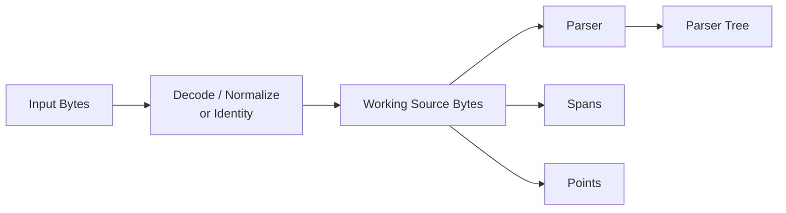

# Astars Source Model

ステータス: Draft

関連文書:

- [README.md](README.md)
- [PROGRAM_MODEL.ja.md](PROGRAM_MODEL.ja.md)
- [../strategy/STRATEGY.ja.md](../strategy/STRATEGY.ja.md)
- [decisions/0001-state-local-node-identity-and-controlled-errors.ja.md](decisions/0001-state-local-node-identity-and-controlled-errors.ja.md)

## この文書について

この文書は、Astarsがsource codeをどのようなbytes/text/coordinateとして保持し、program structureと対応づけ、編集後に投影するかを定義する。

どのnodeを編集するか、operationをどう適用するかは`OPERATION_MODEL`、node identityとProgram Stateは[PROGRAM_MODEL.ja.md](PROGRAM_MODEL.ja.md)で扱う。

## Goals

- parserが参照したsourceとnode spanの座標系を一意にする
- valid UTF-8とinvalid UTF-8の両方を扱う
- file encoding変換前後の表現を混同しない
- nodeから対応するsource bytes / textを取得できる
- diagnosticをsource coordinateへ戻せる
- text spliceからgraph-native source projectionへ段階的に発展できる
- formatting / triviaの保証範囲を明示する

## Non-Goals

- すべてのencodingをlosslessに相互変換する
- grapheme-aware editor APIを初期coreへ持つ
- semantic formattingやstyle normalizationを行う
- Stage 2で完全なpretty-printerを提供する
- sourceだけから未知の編集意図を推定する

## Source Representations

### Input Representation

Astarsへ渡された入力表現。

- `parse_str`: language bindingのstring
- `parse_bytes`: raw bytes
- `parse_file`: file bytesとencoding指定

Input Representationは、必ずしもparserへ渡すbytesと同一ではない。特に`parse_file`でnon-UTF-8 encodingをdecodeし、UTF-8へencodeし直す場合は異なる。

### Working Source Bytes

parserへ渡し、node span、edit、diagnosticsの基準とするbytes。

Target Modelでは、すべてのbyte offsetを「どのsource revisionのWorking Source Bytesに対するoffsetか」と結びつける。



現在の`parse_bytes`ではinput bytesとworking bytesが同じである。`parse_file(..., encoding)`ではdecode後のUTF-8 bytesがworking bytesになるため、spanは元file bytesのoffsetではない。

### Decoded Text View

human-readable API向けにWorking Source Bytesをtextへ変換したview。

Working Source Bytesがinvalid UTF-8を含む場合、text viewはreplacement characterを使ったlossy decodeでよい。ただし、text viewのcharacter indexを元bytesのoffsetとして再利用してはならない。

```text
raw bytes:    [valid][invalid][valid]
text view:    "...�..."
byte offsets: raw bytes上で維持
```

lossy textは表示・比較用のviewであり、canonical source storageではない。

### Original File Representation

将来、file encodingや元bytesを保持する必要がある場合、Working Source Bytesと分離して扱う。

候補情報:

- original bytes
- requested / detected encoding
- decoding時のmalformed sequence有無
- BOM
- newline convention

現行実装はこれらを完全には保持しない。保持をpublic contractにするかは未決定である。

## Source Revision

各Program Stateのsourceは、一つのsource revisionとして扱う。

- spanはrevision-localである
- 異なるrevisionの同じ数値offsetは比較しない
- operationによりsourceが変化すると、新しいrevisionが生じる
- old spanとnew spanを同じcoordinate systemとして扱わない

現在の`EditResult`が`old_changed_ranges`と`changed_ranges`を分けるのは、この原則の限定的な実装である。

Source Revisionへ明示的なIDを導入するか、Program State identityで代表するかは未決定とする。

## Coordinate Model

### ByteSpan

source範囲は半開区間`[start_byte, end_byte)`で表現する。

```text
start_byte <= end_byte <= working_source.len()
```

- empty spanは`start_byte == end_byte`
- EOFは`working_source.len()`
- node coverageとinsertion pointは別の意味を持ち得る
- spanは所属source revisionなしに比較しない

### Point

Pointは0-basedの`(line, column)`とする。

- `line`: 0-based
- `column`: line先頭からのbyte数
- `column`はUnicode code point数でもgrapheme cluster数でもない

byte columnを採用する理由:

- parser / byte spanとの変換が一意
- invalid UTF-8でも定義可能
- tree-sitterのPointと整合する

UI向けのcode point / grapheme columnが必要な場合は、別のview/helperとして提供する。coreのcanonical coordinateへ混在させない。

### Offset Validation

public APIへ渡されたoffsetはWorking Source Bytesの範囲内か検証する。

- `node_at(offset)`: half-open node coverageに従い、EOFでは`None`を返し得る
- `point_at(offset)`: `0..=len`のどこまで許可するかをAPI contractで明示する
- `source_slice(span)`: malformed / out-of-range spanをerrorにする

範囲外offsetでslice panicを起こさない。

### Newline

line計算のcanonical delimiterは現行実装と同じくLF(`\n`)を基準とする。

CRLFをWorking Source Bytes内で保持する場合、`\r`はline末尾のbyteとしてcolumnに含まれ、`\n`で次lineへ進む。入力時にnewline normalizationを行う場合は、元file offsetとの対応が変わるため明示的に記録する。

newlineを常にnormalizeするか保持するかは、source projection設計と合わせて今後決める。

## Source Mapping

### Source-Backed Node

Working Source Bytes上の一つ以上の範囲に対応するnode。

現在のSyntax Nodeは単一のcovering `ByteSpan`を持つ。将来normalized structureを導入すると、一つのnodeが複数の不連続spanに由来する可能性がある。

```text
Syntax Node        -> one contiguous span (current)
Normalized Node    -> one or more origin spans (future)
```

many-to-many mappingが必要になった場合、単一covering spanだけで由来を代表させない。

### Source-Unbacked Node

graph-native editで挿入されたが、まだsourceへ投影されていないnode等。

source-unbacked nodeへ偽の`0..0`spanを割り当てない。`None`、mapping enum、別origin relation等で「未投影」を表現する。

### Deleted Source

削除operation後のactive sourceには、削除nodeのspanは存在しない。

削除前revisionのspanとsource sliceはprovenanceとして参照可能にする方向を目指す。new revision上のempty spanだけで削除情報を代表させない。

## Diagnostics and Source Locations

diagnosticは、可能な限り発生源とsource revisionを持つ。

主な発生源:

- parser recovery
- operation validation
- source projection
- external compiler / evaluator

parser diagnosticはtree-sitterの`ERROR` / `MISSING` nodeから取得できる。これはparserが観測した構文状態であり、Astarsが把握するedit provenanceとは別情報である。

zero-width diagnostic spanを許可する。missing token等は挿入位置だけを持つ場合がある。

## Source Editing and Projection

### Stage 2: Text Splice

現在の`replace`は、target nodeのspanを使ってWorking Source Bytesをspliceする。

```text
new_source = old[..start] + replacement + old[end..]
```

その後、tree-sitterへ`InputEdit`を通知し、incremental re-parseする。

この方式の性質:

- target addressingはstructure-aware
- payloadはtext
- surrounding sourceを保持しやすい
- replacementの構文的妥当性は保証しない
- indentation / separator / formattingは呼び出し側payloadに依存する

### Future: Structural Projection

graph-native operationでは、program structureからsource表現を得る必要がある。

候補:

- localized patch generation
- syntax-aware insertion helper
- lossless CST rewrite
- pretty-printer / code generator
- original source + operation overlay

すべてを一方式へ統一する必要はない。operation粒度とsource fidelity要求に応じて使い分けられるmodelを目指す。

### Projection Result

source projectionは常に成功するとは限らない。

結果として区別すべき状態:

- sourceへ完全に投影できた
- incomplete sourceとして投影できた
- formatting情報を一部失って投影した
- graph上では表現できるがsourceへ投影できない
- projection error

projection failureでProgram State自体を失わない。

## Formatting and Trivia

comment、whitespace、parentheses、quote style等をどこまでstructureとして扱うかはlayerによって異なる。

- parser CSTは多くのsource detailを保持できる
- normalized ASTは分析しやすさのためdetailを落とし得る
- source-faithful editではtriviaの保持が重要
- graph-native operationでは新規nodeのformatting生成が必要になる

Target Modelは、losslessを保証するoperationと、formatting変更を許すoperationを区別できる必要がある。初期段階で全operationの完全losslessを約束しない。

## Source Model Invariants

1. すべてのspan / pointは一つのWorking Source Bytes revisionに属する
2. parserへ渡したbytesとspanの座標系を一致させる
3. lossy decoded textのcharacter indexをcanonical byte offsetとして扱わない
4. out-of-range offset / spanでpanicしない
5. source-unbacked nodeへ偽のspanを付与しない
6. old / new revisionのspanを明示なしに比較しない
7. diagnosticは可能な限りsource revisionと発生源を識別できる
8. projection failureでもstructural stateとoperation provenanceを保持できる
9. encoding / newline normalizationを行う場合、元bytesとのoffset差を隠さない

## Current Stage

現在のRust coreは次を実装している。

- sourceを`Vec<u8>`として`SyntaxTree`内に保持
- `parse_str`はUTF-8 bytesを渡す
- `parse_bytes`はinvalid UTF-8を許可
- `parse_file`は指定encodingをdecodeしてからUTF-8 bytesとしてparse
- `ByteSpan`はhalf-open byte range
- `Point`は0-based line / byte column
- `source_of`はlossy UTF-8 decode
- parser diagnosticはtree-sitter recovery nodeから取得
- `replace` / `diff_with`は新しいsource bytesを生成

## Known Gaps

- spanがどのProgram State / source revisionに属するか型で表現していない
- `point_at`等の一部public inputが範囲外でpanicし得る
- `parse_file`がoriginal file bytes / encoding / malformed flagを保持しない
- decoded UTF-8 spanとoriginal file byte offsetを対応づけられない
- full source bytesを安全に取得するpublic APIが整理されていない
- normalized nodeの不連続origin spanを表現できない
- source-unbacked nodeを表現できない
- formatting / trivia preservationのcontractがない
- projection resultの型がない
- repeated point lookupはsource先頭から線形scanする

## Open Questions

- original file bytesをProgram Stateへ保持するか
- transcoding mappingを必要とするuse caseがあるか
- newlineを保持するかcanonical formへnormalizeするか
- multi-span originをどの型で表現するか
- source revision identityを独立型にするかStateIdで代表するか
- text splice、localized printer、full regenerationをどう選択するか
- comment / whitespaceをsyntax nodeとして公開するかtrivia mappingにするか
- projectionのlossless levelをどう表現するか
