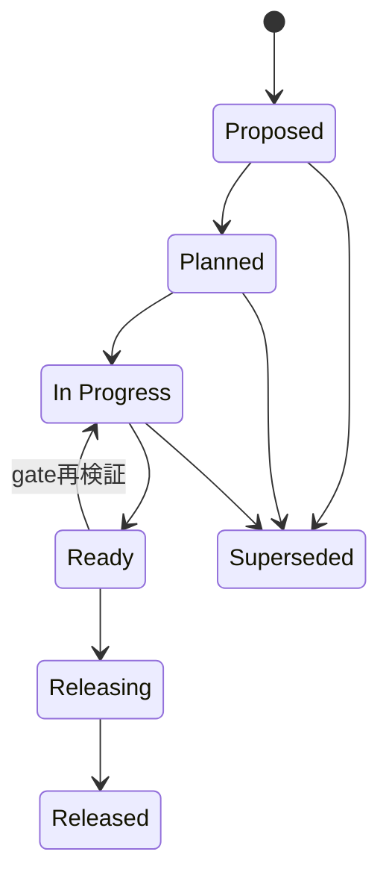

# Astars Next Release

Status: Proposed

Target Version: `v0.3.0` candidate

Baseline: `v0.2.0`（tag: 2026-10-23、registry publication完了: 2026-11-01）

関連文書:

- [RELEASE_POLICY.ja.md](RELEASE_POLICY.ja.md)
- [RELEASE_PROCESS.ja.md](RELEASE_PROCESS.ja.md)
- [../strategy/ROADMAP.ja.md](../strategy/ROADMAP.ja.md)
- [../design/OPERATION_MODEL.ja.md](../design/OPERATION_MODEL.ja.md)
- [../design/PROVENANCE_MODEL.ja.md](../design/PROVENANCE_MODEL.ja.md)
- [../design/decisions/0003-analysis-neutral-field-navigation.ja.md](../design/decisions/0003-analysis-neutral-field-navigation.ja.md)
- [../design/decisions/0004-independent-source-diff-is-inferred.ja.md](../design/decisions/0004-independent-source-diff-is-inferred.ja.md)

## Status Lifecycle

- **Proposed**: scopeとversionの候補を議論している
- **Planned**: release objectiveとscopeを承認した
- **In Progress**: scope内の実装・文書化・検証を進めている
- **Ready**: version、changelog、artifact検証を含むrelease gateを満たし、release commitを確定できる
- **Releasing**: release commit確定後、tag、publishを進めている
- **Released**: registry検証まで完了した
- **Superseded**: releaseせず別計画へ置き換えた

## Release Objective

`v0.2.0`以降に実装されたStage 2の追加capabilityを、意味上の制約を明示した上でPython / Node利用者へ届ける。

このreleaseはfirst-class OperationやProvenance Graphを導入するStage 3 / 4 releaseではない。現在のstructure queryとsource-based edit / diffを利用可能なbaselineとして確定する。

## Proposed Scope

### Field-based Navigation

- `SyntaxTree::child_by_field_name`
- Python: `PySyntaxTree.child_by_field_name`
- Node: `JsSyntaxTree.childByFieldName`
- `name`を特別扱いしないanalysis-neutralなfield navigation
- Python / Node example

### Independent Source Diff Approximation

- `SyntaxTree::diff_with`
- `EditResult::unchanged`
- Python / Node bindingへの公開
- line-based diffから`InputEdit`列を構築するStage 2実装
- old / new coordinate systemを分けたchanged-range判定
- Python / Node example

このdiffはnode identityやrename / moveを推定しない。known operation lineageではなく、独立source間のchanged-range approximationとして公開する。

### Documentation Contract

- Program / Source / Operation / Provenance Model
- ADR 0003 / 0004
- known lineageとinferred correspondenceの区別
- 現行APIとtarget modelのgap

## Non-Goals

- first-class serialized Operation
- StateId / OperationId
- Provenance Graph / node lineage
- GumTree等によるstructural matching
- selector DSL
- Python以外のprogramming language support
- `astars-core`のcrates.io publish
- automated registry publish

## Public API Changes

| Surface | Change | Compatibility |
|---|---|---|
| Rust | `child_by_field_name`追加 | additive |
| Rust | `diff_with`追加 | additive |
| Rust | `EditResult::unchanged`追加 | additive |
| Python | field navigation / diff query追加 | additive |
| Node | field navigation / diff query追加 | additive |
| Changed-range behavior | old / new coordinateを分離 | bug fix、結果が変わり得る |

削除予定APIや必須migrationは、現時点ではない。

## Required Evidence

- Rust workspaceのfmt / clippy / test / release buildが通る
- Python wheelをclean environmentへinstallし、exampleが通る
- Node packageをclean projectへinstallし、exampleが通る
- field navigationがPython / Nodeで同じnodeを解決する
- `diff_with`のold / new両側でchanged / unchanged判定を検証できる
- non-UTF-8 sourceに対する既存方針を壊さない
- API documentationがADR 0003 / 0004と矛盾しない

## Release Gates

Statusを`Ready`へ進める前に、`RELEASE_PROCESS`のstep 1–6を実施し、次を決定・完了する。

- [ ] target versionを`v0.3.0`として確定する
- [ ] field navigationとindependent diffを同じreleaseへ含めることを承認する
- [ ] public API reviewを完了する
- [ ] required evidenceをclean checkoutで再実行する
- [ ] version metadataを揃える
- [ ] changelogを確定する
- [ ] Known Limitationsをrelease noteへ反映する

`Ready`以降はscope、version、artifact内容を変更しない。変更が必要になった場合はStatusを`In Progress`へ戻し、影響するverificationを再実行する。

## Open Decisions

- independent diff APIをStage 2 approximationとして今releaseするか
- `EditResult`をknown editとinferred diffで共有したまま公開するか
- `v0.3.0`後にStage 3のOperation Modelへ進むか、先にreference workflowを実証するか

## Release Checklist

- [ ] Scope frozen
- [ ] Version aligned
- [ ] Changelog finalized
- [ ] Workspace verified
- [ ] Python artifact verified
- [ ] Node artifact verified
- [ ] Release commit merged to `main`
- [ ] Tag created and pushed
- [ ] PyPI published and verified
- [ ] npm published and verified
- [ ] Release result recorded

詳細な手順は[RELEASE_PROCESS.ja.md](RELEASE_PROCESS.ja.md)に従う。

## Release Result

Statusが`Released`になった時点で、tag date、registry publish完了日、tag commit、published artifact、既知の問題を記録する。次回releaseの検討を開始する際は、公開済み情報を`CHANGELOG.md`とGit tagへ残し、本書を次のscopeへ更新する。
