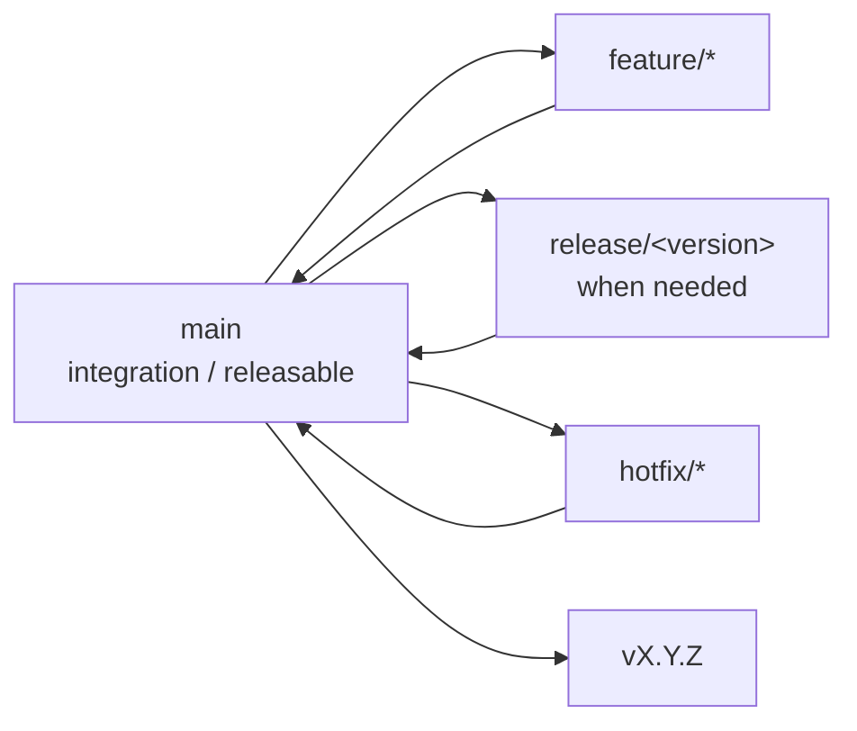

# Astars Release Policy

ステータス: Active

関連文書:

- [RELEASE_PROCESS.ja.md](RELEASE_PROCESS.ja.md)
- [NEXT_RELEASE.ja.md](NEXT_RELEASE.ja.md)
- [../strategy/ROADMAP.ja.md](../strategy/ROADMAP.ja.md)
- [../../CHANGELOG.md](../../CHANGELOG.md)

## この文書について

この文書は、Astarsのrelease unit、versioning、compatibility、tag、branchに関する長期的な規約を定義する。具体的なrelease手順は`RELEASE_PROCESS`、次回だけのscopeとgateは`NEXT_RELEASE`が扱う。

現在のversionや作業進捗、完了済みreleaseの詳細は本書へ記載しない。

## Release Unit

AstarsはRust coreとPython / Node bindingを一つのrelease unitとして扱う。

| Component | Distribution | Public name | Publication |
|---|---|---|---|
| Rust core | Cargo workspace | `astars-core` | crates.io公開は未決定 |
| Python binding | PyPI | `astars-py` / module `_astars` | publishする |
| Node binding | npm | `@astars/native` | publishする |

3 componentは同じversion番号へ揃える。bindingごとの独立versioningは、release cadenceを分ける具体的な必要が生じるまで導入しない。

## Versioning Policy

`MAJOR.MINOR.PATCH`形式を使う。

- `v0.x`のminor releaseは、機能追加と必要なbreaking changeを含み得る
- patch releaseは、同じminor lineに対する互換性を意図したbug fixとrelease修正に使う
- publish済みversionは再利用しない
- Python、Node、Cargo metadataのversionはrelease前に一致させる
- `v1.0.0`はpublic API stabilityを宣言できる条件が定まるまで設定しない

旧Python-only implementationの`v0.1.0`とRust core以降は実装系統が異なるが、repositoryのversion sequenceは継続する。

## Compatibility Policy

`v0.x`ではAPI変更を許容する。ただし、breaking changeを無通知で混入させない。

releaseごとに次を明示する。

- public APIの追加・変更・削除
- source / serialized data compatibilityへの影響
- Python / Node binding間のsemantic parity
- migrationが必要な場合の手順

bindingの外形はruntime制約により異なってよいが、同じcore operationの意味論は一致させる。

## Branch Policy



- `main`は統合branchであり、常にbuild / test可能な状態を保つ
- `main`のHEADが常に最新release tagと一致する必要はない
- feature branchは一つの明確なscopeを持ち、merge後に閉じる
- release準備を複数commitで行う場合のみ`release/<version>`を使う
- hotfixも通常のreview / verificationを通して`main`へ戻す
- publish対象commitは`main`に存在し、そのcommitへrelease tagを付ける

## Tag Policy

tagは`vMAJOR.MINOR.PATCH`形式とする。

```text
v0.2.0
v0.3.0
```

- annotated tagを使う
- tagが指すcommitとpublish artifactのsourceを一致させる
- PyPI / npm / Cargo metadataのversionとtagを一致させる
- tagの移動やpublish済みtagの上書きをしない

## Publication Invariants

releaseは次を満たさなければならない。

1. `NEXT_RELEASE`のscopeがfreezeされている
2. required verificationがclean checkoutで成功している
3. version metadataが一致している
4. changelogが対象versionについて確定している
5. tag対象commitが`main`に存在する
6. Python / Node artifactが同じcore semanticsを公開する
7. publish後にregistryからinstallしてsmoke testできる

一方のregistryだけpublishされたpartial releaseを、同一versionの再利用で修復しない。artifactを変更せず再実行できない場合は、原因を修正して新しいpatch versionを発行する。

## Release Record

公開済みreleaseの事実は次を正とする。

- Git tag
- registry上のartifact
- `CHANGELOG.md`
- GitHub Releaseを使う場合はそのrelease note

`CHANGELOG.md`のversion見出しにはtag dateを記録する。registryへの公開が同日でない場合は、各registryのpublish完了日をrelease recordへ併記し、tag dateと「利用可能になった日」を混同しない。

完了済みreleaseの作業記録を`NEXT_RELEASE`へ残し続けない。

## Open Decisions

- `astars-core`をcrates.ioへpublishするか
- `v1.0.0`のstability gate
- bindingをlockstep versioningから分離する条件
- release signing / provenance attestationを導入する時期
