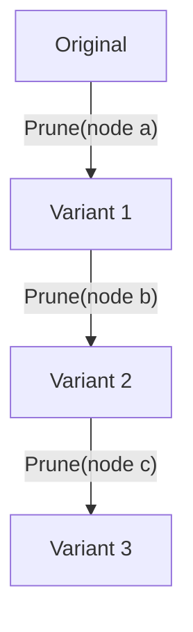
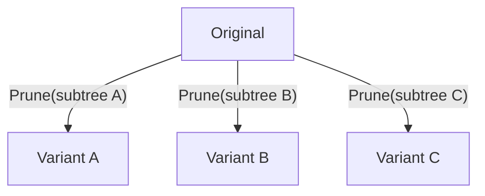

# Astars ユースケース

ステータス: 戦略再構成中

関連戦略: [STRATEGY.ja.md](STRATEGY.ja.md)

この文書は、Astars の設計と実装を検証する具体的な workflow を定義する。可能性のある用途を並列に列挙するのではなく、primary use case、secondary validation、将来候補を区別する。

## 優先順位

1. **Primary**: 研究用の program variant 生成・追跡・評価
2. **Secondary validation**: LLM coding agent による構造化編集
3. **Future candidates**: repository mining、review、migration、metrics、visualization 等

Primary use case で必要性が確認できない primitive を、「汎用 engine ならいつか使う」という理由だけで追加しない。Secondary use case は、primary で得た primitive が別領域でも再利用できるかを検証する。

## Primary Use Case: Program Variant Research

### 目的

研究者が program structure を基準にコードを編集し、複数の variant を生成し、各 variant の source・構造・編集系列・評価結果を対応づけられるようにする。

Astars は研究仮説や評価関数を所有しない。研究者が独自の pruning strategy、mutation strategy、distance metric、model evaluation を実装できる共通 substrate を提供する。

### Scenario A: Sequential Pruning

一つ前の variant に対して削除を繰り返し、累積的な編集系列を生成する。



必要な capability:

- node を安定した順序で traverse する
- node を source と対応づける
- delete operation を適用・記録する
- variant の parent を保持する
- 各 state の diagnostics / validity を観測する
- 削除された node の origin を追跡する

### Scenario B: Independent Subtree Variants

同じ origin から異なる subtree を削除し、互いに独立した variant を生成する。



必要な capability:

- origin state を再利用する
- cumulative edit と independent edit を区別する
- subtree を一つの structural target として扱う
- variant 間で node / operation provenance を比較する

### Scenario C: Incomplete Intermediate State

node や token 相当の要素を削除した結果、source が構文不完全になる場合でも、その state を捨てずに保持する。

例:

```c
sum =
```

この状態について、単に「parse error」とするだけでなく、元の assignment の right side を削除した結果であることを説明できる状態を目指す。

必要な capability:

- parser diagnostics と edit provenance を分離する
- 欠落した要素と元 node の関係を保持する
- incomplete state を variant graph に含める
- source へ投影できる範囲と、構造上のみ存在する情報を区別する

### Scenario D: Edit Dataset Generation

構造操作から編集コード群を生成し、code similarity、edit distance、LLM / code model evaluation の dataset として利用する。

Astars が提供するもの:

- 再現可能な operation sequence
- before / after program state
- source span と structural target
- lineage / provenance
- diagnostics / validity

downstream が定義するもの:

- operation の sampling policy
- label、distance、score
- training / evaluation split
- model と学習方法

### Primary Use Case の end-to-end 完了条件

一つの Python source から、少なくとも次を自動実行できること。

1. parse して structural target を列挙する
2. sequential variant と independent subtree variant を生成する
3. valid / incomplete を問わず全 state を保持する
4. 各 variant の origin、parent operation、対象 node を問い合わせる
5. source、structure、operation log を再現可能な形で export する
6. downstream の任意評価関数を各 variant に適用する

この workflow が core private API や parser 固有 object へ依存せず成立することを、最終像に向けた主要な実証とする。

## Secondary Validation: LLM Structural Editing

### 目的

LLM にファイル全体の転記や曖昧な行番号指定だけを要求せず、program structure を使って編集対象と操作を表現させる。

LLM agent 自体、prompt strategy、model selection は Astars の責務ではない。Astars は agent が利用できる addressing、operation validation、application、post-edit inspection を提供する。

### Scenario E: Structure-Addressed Replacement

LLM が「関数 `process` の body を置換する」のように対象を指定し、Astars が node を解決して source edit を適用する。

これは現在の stage に最も近い。必要なのは、曖昧な selector の扱い、再 parse、diagnostics、意図しない範囲が変わっていないかの確認である。

### Scenario F: Relative Insertion

LLM が「`return` の前に `validate(value)` を挿入する」と指定する。

段階的な実装候補:

1. target node + insertion text
2. target node + relative position + insertion text
3. target node + structural node description

indentation、separator、comment、formatting の責任範囲は各段階で実証してから拡張する。

### Scenario G: Operation Plan

LLM が source patch ではなく structural operation の列を返す。

```json
{
  "operation": "insert_before",
  "target": {
    "kind": "return_statement",
    "inside_function": "process"
  },
  "content": "validate(value)"
}
```

Astars は target resolution、ambiguity、operation application、diagnostics、lineage を扱う。操作が意味的に適切かは agent / downstream が判断する。

### Secondary Validation の成功条件

- モデルが無関係な周辺 source を転記せずに編集できる
- target が一意でない場合に silent に適用しない
- operation と適用結果を対応づけて記録できる
- 構文不完全な結果も失敗として消さず、diagnostics 付き state として返せる
- 同じ operation model が研究用 variant generation と共有される

最後の条件が重要である。LLM 専用 API を別系統で増やすのではなく、Primary use case で確立した structural edit model の再利用性を検証する。

## Future Validation Candidates

次は有望な用途だが、現時点では roadmap を駆動しない。

### Structural Diff / Change Understanding

二つの独立した program state 間で node を対応づけ、insert/delete/update/move を得る。GumTree 型の matching は variant lineage がない比較に必要となる。

現在の line-based `diff_with` は暫定的な byte-range classification であり、最終的な structural diff ではない。

### Repository Mining / Code Similarity

repository 群から structure、source span、edit history を抽出し、clone detection や similarity research に利用する。

### Migration / Refactoring

構造で対象を選び、recipe に従って edit operation を適用する。recipe と migration policy は downstream が所有する。

### Review / Test Impact / Architecture Rule

structural diff や query result を source span へ戻し、review や CI の判断材料にする。review policy や test selection は downstream が所有する。

### Visualization

program state、source mapping、operation sequence、variant lineage を可視化する。これは graph model の観測・debug 手段として有用だが、Astars core 自体を visualization product にはしない。

### Language Expansion

second language を追加し、operation と provenance model が Python 固有ではないことを検証する。language count を増やすこと自体を目的にしない。

## Use Case から外す判断

次のような要望は、Astars core へ直接入れない。

- 特定研究の pruning 順序を標準戦略にする
- 特定 LLM の prompt / tool protocol を core に固定する
- code quality score や review rule を組み込む
- complete compiler frontend / semantic analyzer を作る
- arbitrary malformed source から編集意図を推定する
- consumer のない CLI、DSL、service interface を先に増やす
